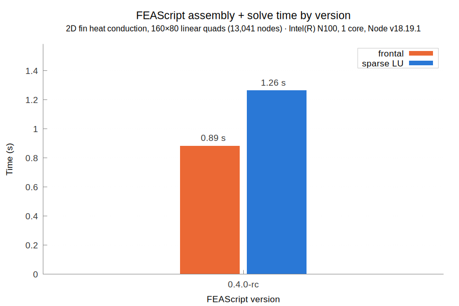

# FEAScript-benchmark

This repository contains benchmarks for [FEAScript](https://feascript.com/), the finite element simulation library developed in JavaScript. Each benchmark runs FEAScript and an established finite element solver on the same problem and compares them on accuracy and run time, against an exact solution where one exists. Results are kept for every FEAScript version, so the comparison can be followed as FEAScript develops.

## Benchmarks

| Benchmark | Compared with | Problem |
|---|---|---|
| [heatConduction2DFin](heatConduction2DFin/) | [Elmer](https://www.elmerfem.org/) | 2D heat conduction in a fin with constant-temperature, symmetry and convection boundaries, on linear and quadratic quadrilateral meshes from 231 to 51,681 nodes |

📖 Each benchmark folder has a README with the problem, the setup, the results and the steps to run it.

## How the benchmarks are run

- **Same problem, same meshes:** both codes solve identical meshes, so their nodal results can be compared one to one
- **One core:** every timed process is pinned to one core, so neither code gains from multithreading
- **Fresh processes:** each timing is the median of several fresh processes
- **FEAScript as users load it:** the benchmarks load the built bundle `dist/feascript.esm.js` from a [FEAScript-core](https://github.com/FEAScript/FEAScript-core) checkout, by default the sibling folder `../FEAScript-core`
- **Recorded setup:** each run writes a `meta.json` with the FEAScript version and commit, the versions of the other software, the CPU and the date

## License

FEAScript-benchmark contains code and content, and each has its own terms:

| What | License |
|---|---|
| Code: the scripts and input templates (`*.py`, `*.mjs`, `*.sif.in`) | [MIT](LICENSE) |
| Content: the results, plots and READMEs | [CC BY 4.0](LICENSE-CONTENT) |
| The FEAScript logo and the name "FEAScript" | Not licensed, all rights reserved |

Credit CC BY material as: *"FEAScript-benchmark by FEAScript, CC BY 4.0"*, and note any changes you made.

Third-party software that the benchmarks run is listed in [NOTICE.md](NOTICE.md). Note that the core library of FEAScript is distributed under the terms of the [MIT license](https://github.com/FEAScript/FEAScript-core/blob/main/LICENSE).
