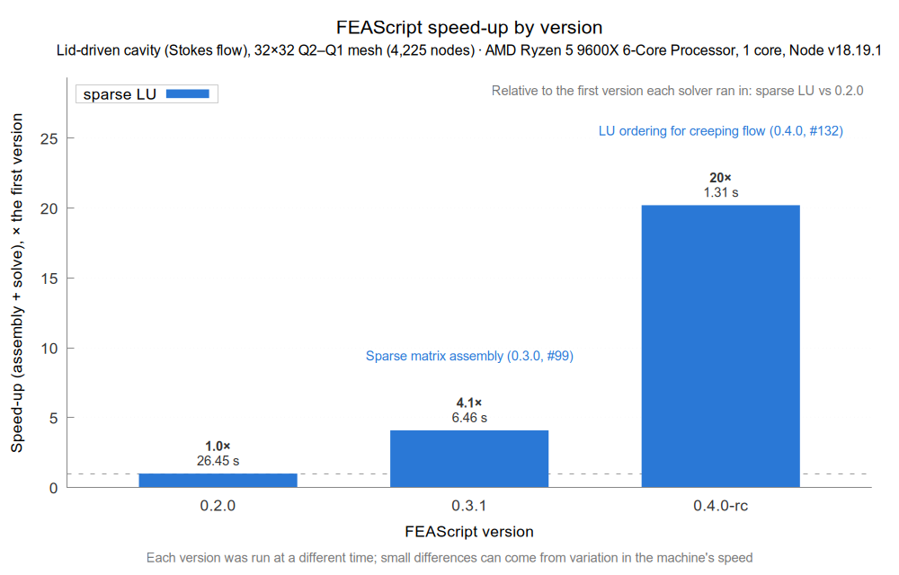

# FEAScript vs Elmer benchmark: lid-driven cavity

This folder compares [FEAScript](https://feascript.com/) with the [Elmer](https://www.elmerfem.org/) finite element solver on Stokes (creeping) flow in the lid-driven cavity, a standard test of incompressible flow solvers and the problem of the [creeping flow example](https://github.com/FEAScript/FEAScript-core/tree/main/examples/creepingFlowScript) of FEAScript-core. Both codes solve it with the same elements on identical meshes and are compared on the flow they compute and on run time. Each machine and FEAScript version gets its own set of results, so the comparison can be repeated as FEAScript develops.

## Contents

- [Results](#results)
- [The problem](#the-problem)
- [What is measured](#what-is-measured)
- [How to run the benchmark](#how-to-run-the-benchmark)
- [License](#license)

## Results

The results are in `results/<machine>/<version>/`:

| Machine | FEAScript version | Results |
|---|---|---|
| AMD Ryzen 5 9600X | 0.2.0 | [results/amd-ryzen-5-9600x/0.2.0/](results/amd-ryzen-5-9600x/0.2.0/) |
| AMD Ryzen 5 9600X | 0.3.1 | [results/amd-ryzen-5-9600x/0.3.1/](results/amd-ryzen-5-9600x/0.3.1/) |
| AMD Ryzen 5 9600X | 0.4.0-rc | [results/amd-ryzen-5-9600x/0.4.0-rc/](results/amd-ryzen-5-9600x/0.4.0-rc/) |

FEAScript's speed-up on the 32×32 mesh by version, with the assembly and solve time of each run, on the AMD Ryzen 5 9600X:



📖 Each results folder has a README with the plots of that run, a table of all the numbers (`results_table.md`) and the details of the run (`meta.json`): the FEAScript version and commit, the versions of the other software, the machine and the date.

> **About the comparison:** Elmer runs here on one core, as a single MPI process, on small 2D problems, so that both codes are compared on the same terms. Elmer is a parallel code built for much larger problems, and this setup does not show its parallel performance. Its end-to-end time includes a fixed MPI start-up in the build used here, about 0.5 s on the AMD Ryzen 5 9600X. See [About the comparison](../README.md#about-the-comparison).

## The problem

- **Domain:** unit square, viscosity μ = 1
- **Lid:** velocity (1, 0) on the top edge
- **Walls:** no-slip, velocity (0, 0), on the other three edges. The walls win at the two lid corners, so the lid moves only between them
- **Pressure:** fixed to 0 at (0, 0), since an enclosed flow determines the pressure only up to a constant
- **Elements:** Taylor–Hood Q2–Q1 quadrilaterals (quadratic velocity, linear pressure) in both codes. FEAScript uses nodal Q2 elements; Elmer uses hierarchic Q2 velocity on a bilinear mesh (`Element = "p:2"`)

The problem has no exact solution, and the velocity is discontinuous at the two lid corners, where the moving lid meets the fixed walls.

## What is measured

Both codes solve the problem on n × n meshes with n = 8, 16, 24, 32, 48 and 64, from 289 to 16,641 velocity nodes. On each mesh, the benchmark runs:

- **FEAScript:** the `lusolve` (math.js sparse LU) solver, the one that supports creeping flow, loaded from the built bundle `dist/feascript.esm.js` as npm and browser users load it, in Node
- **Elmer:** the `IncompressibleNSVec` solver with `Stokes Flow = True`, with the UMFPACK and MUMPS direct solvers

And compares:

- **Primary vortex strength:** the minimum of the stream function, ψ_min, which lies on the vertical centerline x = 0.5 because Stokes flow in the cavity is symmetric. It is computed the same way for both codes, from the velocity at the mesh vertices on the centerline
- **Velocity:** the difference between the two codes at the mesh vertices, which both codes share, over the whole cavity and away from the two lid corners
- **Centerline profile:** the velocity u along x = 0.5
- **Assembly and solve time:**
  - FEAScript: the time of `model.solve()`, which includes mesh generation
  - Elmer: the `Solver time` of the flow solver, at 0.01 s resolution
- **End-to-end time:** the wall time of the whole process, from start to exit, on the 16 × 16 mesh
- **Peak memory:** the largest resident memory of each process, as GNU time reports it. It is the memory of the whole process, so it includes Node and FEAScript, or Elmer, as well as the problem. Results from before this was measured have no memory

The two codes apply the lid velocity differently next to the corners. FEAScript sets the full lid velocity at every lid node, including the mid-edge node of the corner element. Elmer, with hierarchic elements, interpolates the boundary values linearly along each element edge, so along the top edge of the corner element the lid velocity rises from 0 at the corner. This is part of the comparison: the codes differ near the two lid corners on every mesh, and agree away from them more closely as the mesh is refined.

To keep the comparison fair, every timed process is pinned to one core (`taskset -c 0`, `OMP_NUM_THREADS=1`, `OPENBLAS_NUM_THREADS=1`), and each time is the median of several fresh processes. A run that runs out of memory or exceeds the time limit is recorded as such.

Notes on reading the times:

- **Browsers:** the benchmark runs in Node, which uses the same V8 JavaScript engine as Chrome and other Chromium-based browsers. Browsers with other engines, such as Firefox, can be slower
- **Comparing versions:** each version is benchmarked at a different time, and the speed of a machine varies over time. On the AMD Ryzen 5 9600X, repeated runs of the same build agree to within about 3%; smaller differences between versions in the history plot are within this variation
- **JIT warm-up:** each FEAScript time comes from a fresh process, so it includes JIT warm-up. Repeats inside the same process are in the `warmWall` column

## How to run the benchmark

The benchmark needs Node.js, Python 3 with NumPy, gnuplot, GNU time (`/usr/bin/time`, the `time` package), and ElmerSolver and ElmerGrid on the `PATH`. It benchmarks the [FEAScript-core](https://github.com/FEAScript/FEAScript-core) checkout next to this repository (`../../FEAScript-core` from this folder). Build it first with `npm run build`, since the benchmark loads `dist/feascript.esm.js`.

```
python3 benchmark.py                          # writes results/<machine>/<version>/
python3 make_report.py <machine> <version>    # writes the plots, results_table.md and README.md
python3 ../make_history.py creepingFlow2DLidDrivenCavity  # updates the plots of FEAScript's speed-up by version in history/<machine>/
```

The machine defaults to a name made from the CPU model, e.g. `amd-ryzen-5-9600x`, and the version to the `version` field of `FEAScript-core/package.json`. These environment variables change the run:

- **`FEASCRIPT_MACHINE`:** the name of the machine folder
- **`FEASCRIPT_CORE`:** the path of another FEAScript-core checkout, e.g. a released version
- **`FEASCRIPT_VERSION`:** the name of the version folder, e.g. `FEASCRIPT_VERSION=0.4.0`
- **`FEASCRIPT_COMMIT` and `FEASCRIPT_RELEASE_DATE`:** the commit and release date to record, when `FEASCRIPT_CORE` is not a git checkout
- **`FEASCRIPT_ENTRY=src`:** loads the source files instead of the built bundle
- **`CORE_ID`:** the CPU core to pin the runs to (default 0)
- **`REPS` and `WARM`:** the number of repeats and warm repeats
- **`FEA_TIMEOUT`:** the time limit of a FEAScript process, in seconds
- **`RESUME=1`:** keeps the meshes already in `results.json` and runs only the missing ones
- **`ONLY`:** runs only some meshes, e.g. `ONLY=8,16`

After a run, add a row to [Results](#results) and run `make_history.py`, which picks up every folder in `results/`.

The files in this folder:

- **`benchmark.py`:** runs both codes, compares them and writes the results
- **`make_report.py`:** draws the plots and writes the results table and README of a run
- **`run_feascript.mjs`:** runs one FEAScript case
- **`case.sif.in`:** the Elmer input template
- **`results/meshes/`:** ElmerGrid meshes, shared by all runs and not committed
- **`results/<machine>/<version>/work/`:** Elmer `.sif` files, centerline profiles and FEAScript nodal results (the nodal results are not committed)

## License

This benchmark is released under the [MIT license](../LICENSE). Note that the core library of FEAScript is distributed under the terms of the [MIT license](https://github.com/FEAScript/FEAScript-core/blob/main/LICENSE).
