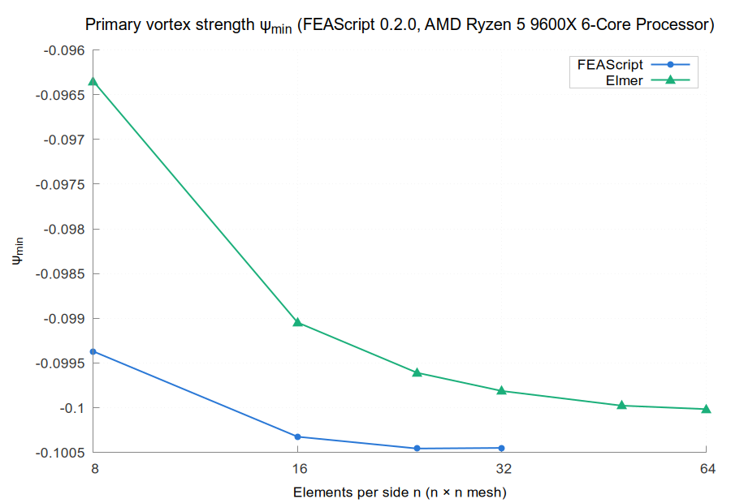
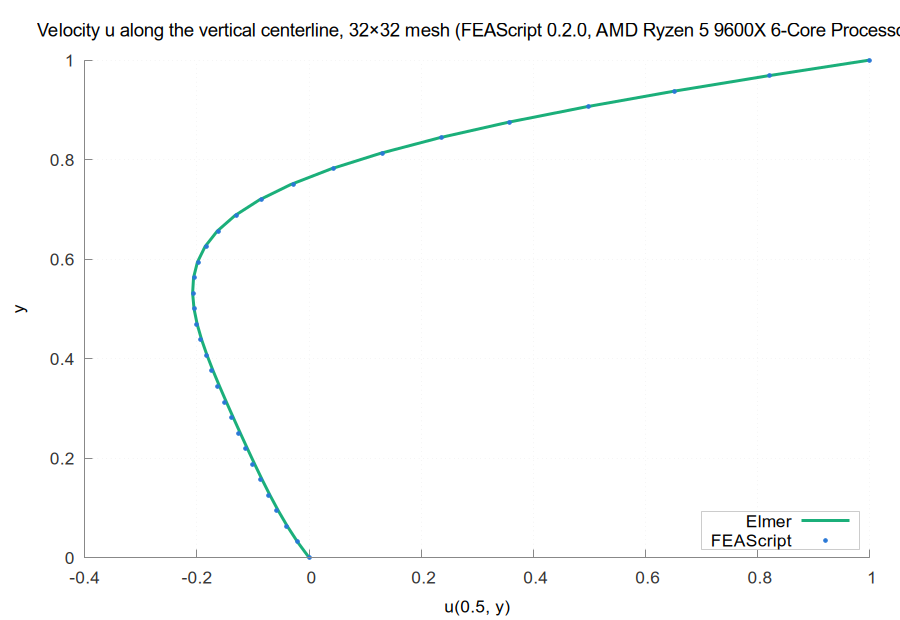
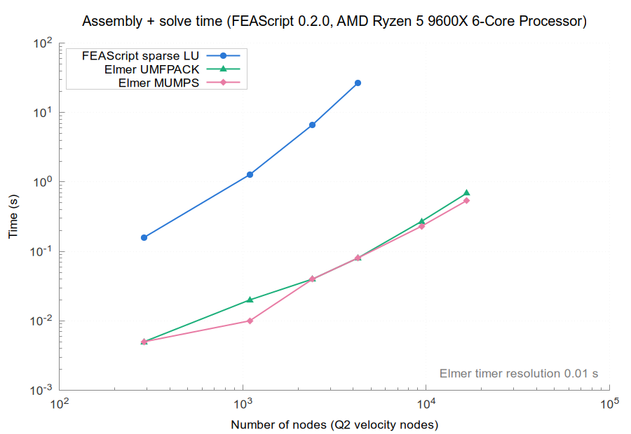
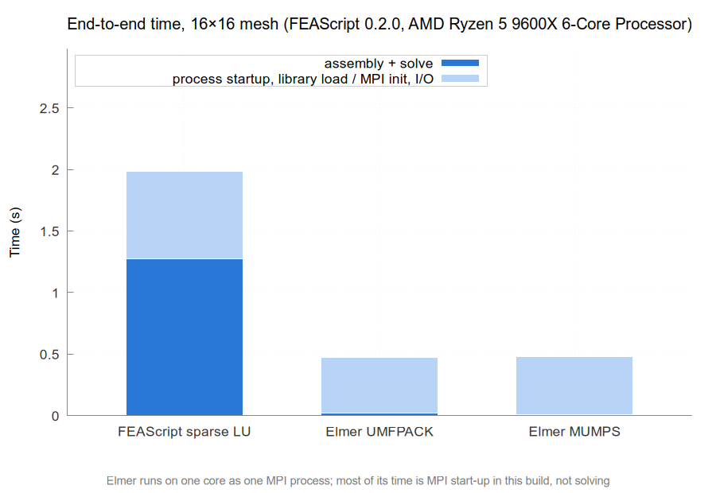
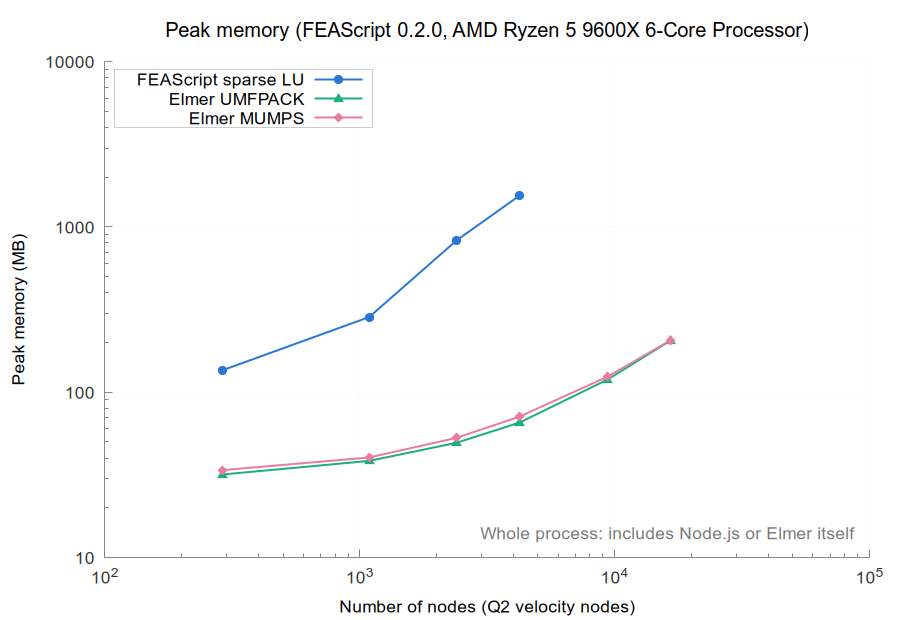

# Results for FEAScript 0.2.0 on AMD Ryzen 5 9600X 6-Core Processor

| | |
|---|---|
| FEAScript version | 0.2.0 |
| FEAScript commit | f526095 |
| Released | 2026-02-25 |
| Loaded from | `dist/feascript.esm.js` |
| Elmer | 26.2 (build of commit `56b16bd49`, 2026-11-02) |
| Node | v18.19.1 |
| Machine | AMD Ryzen 5 9600X 6-Core Processor, 14.7 GB RAM (Linux Mint 22.3, Linux 7.0.0-38-generic) |
| Cores | taskset -c 0, OMP_NUM_THREADS=1, OPENBLAS_NUM_THREADS=1 |
| Repeats | median of 5 fresh processes |
| Run on | 2026-11-04 |

All the numbers are in [results_table.md](results_table.md) and [results.json](results.json).

On every mesh it solved, FEAScript's primary vortex strength ψ_min matches Elmer's (UMFPACK) to within 3.0e-03.

At the nodes farther than 0.2 from the two lid corners, the velocities of the two codes differ by at most 6.2e-02 on the 32×32 mesh, against 1.1e-01 on the 8×8 mesh: the difference does not shrink as the mesh is refined, so the two codes do not converge to the same solution. In FEAScript releases before 0.4.0, the moving lid also set the velocity of one of its corner nodes, so fluid leaked through the side wall there; this was fixed in 0.4.0. Next to the lid corners they differ by up to 1.00 on every mesh: there FEAScript applies the full lid velocity along the top edge of the corner element, while Elmer interpolates it linearly from the corner, where the velocity is 0.

Runs that could not be measured:

- **FEAScript sparse LU, 48x48:** out of memory
- **FEAScript sparse LU, 64x64:** out of memory

Repeated solves that were not run, because the first solve took over 20 s and the case was timed once:

- **FEAScript sparse LU, 32x32**

## Primary vortex strength

## Centerline velocity

## Assembly and solve time

## End-to-end time

## Peak memory

