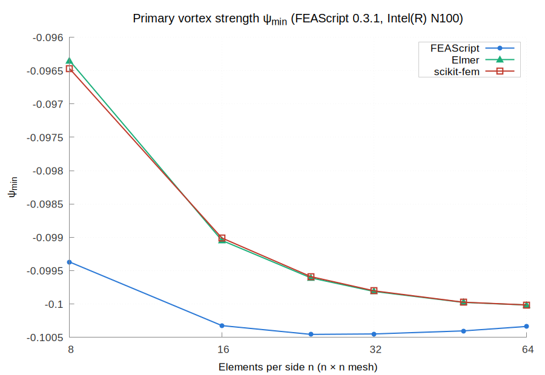
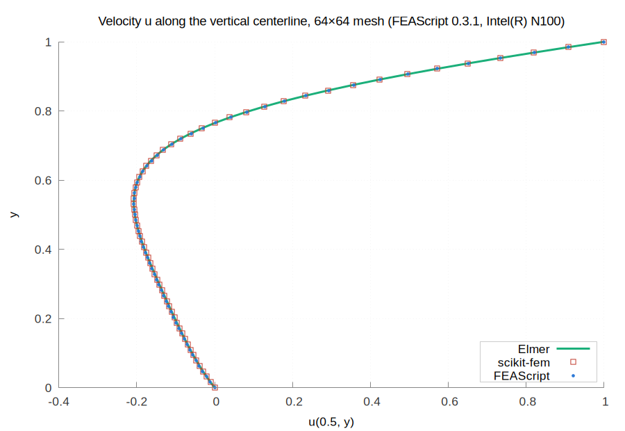
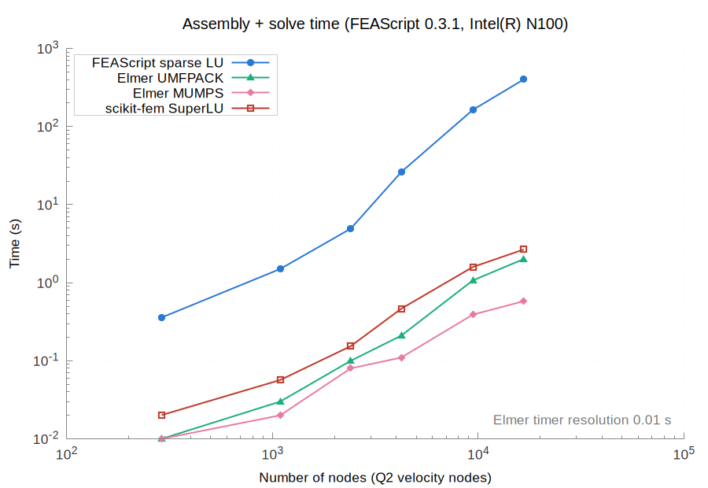
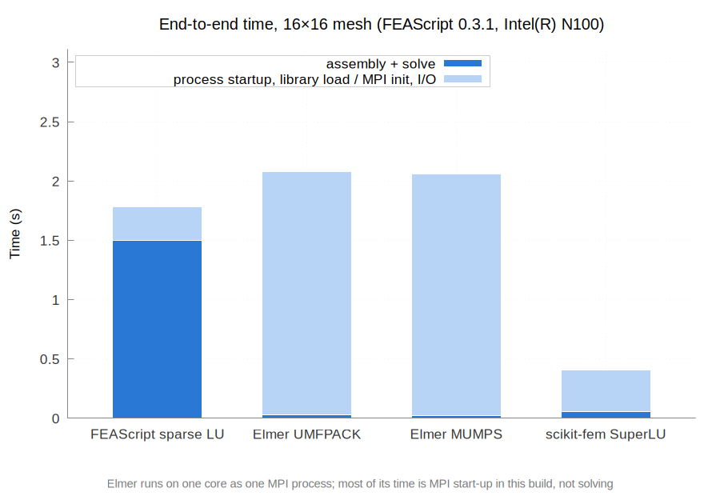
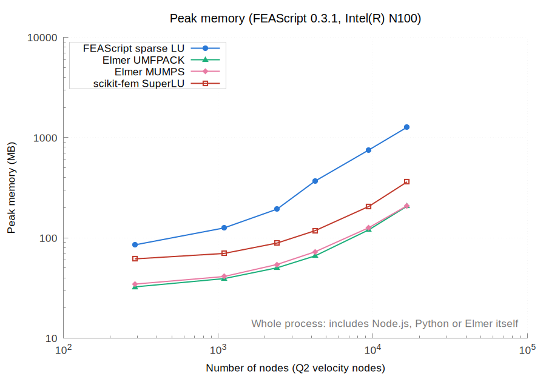
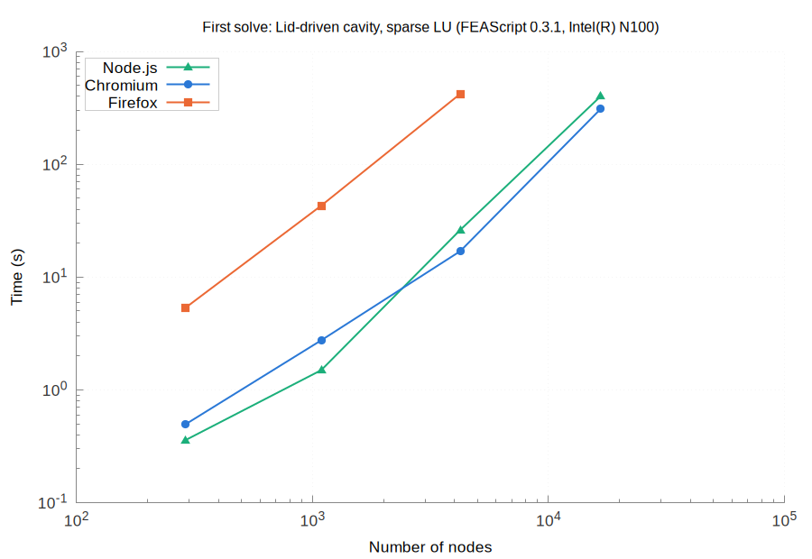
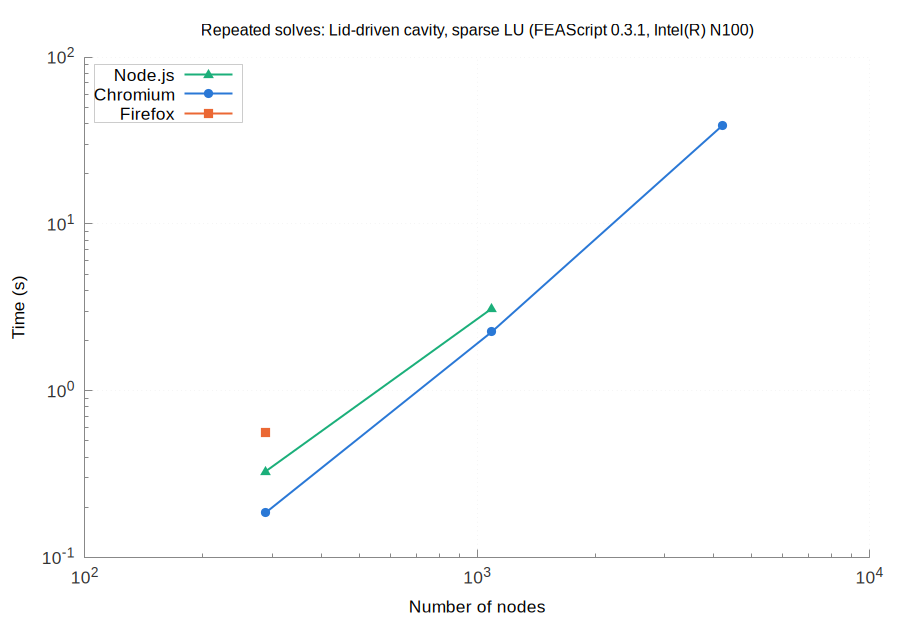

# Results for FEAScript 0.3.1 on Intel(R) N100

| | |
|---|---|
| FEAScript version | 0.3.1 |
| FEAScript commit | 083fc8c |
| Released | 2026-10-30 |
| Loaded from | `dist/feascript.esm.js` |
| Elmer | 26.2 |
| scikit-fem | 12.0.2 (SciPy 1.18.1, NumPy 2.5.4, Python 3.12.3) |
| Node | v18.19.1 |
| Machine | Intel(R) N100, 7.5 GB RAM (Linux Mint 22.3, Linux 7.0.0-42-generic) |
| Cores | taskset -c 0, OMP_NUM_THREADS=1, OPENBLAS_NUM_THREADS=1 |
| Repeats | median of 5 fresh processes |
| Run on | 2026-11-06 |

All the numbers are in [results_table.md](results_table.md) and [results.json](results.json).

On every mesh it solved, FEAScript's primary vortex strength ψ_min matches Elmer's (UMFPACK) to within 3.0e-03.

At the nodes farther than 0.2 from the two lid corners, the velocities of the two codes differ by at most 6.2e-02 on the 64×64 mesh, against 1.1e-01 on the 8×8 mesh: the difference does not shrink as the mesh is refined, so the two codes do not converge to the same solution. In FEAScript releases before 0.4.0, the moving lid also set the velocity of one of its corner nodes, so fluid leaked through the side wall there; this was fixed in 0.4.0. Next to the lid corners they differ by up to 1.00 on every mesh: there FEAScript applies the full lid velocity along the top edge of the corner element, while Elmer interpolates it linearly from the corner, where the velocity is 0.

scikit-fem sets the lid velocity the same way as FEAScript, so the two are compared directly at all their nodes, lid corners included: on every mesh the velocities differ by at most 1.0e+00 and the pressures, at the mesh vertices, by at most 9.1e+02.

Repeated solves not measured yet (a case with a first solve over 20 s used to be timed without one):

- **FEAScript sparse LU, 32x32**
- **FEAScript sparse LU, 48x48**
- **FEAScript sparse LU, 64x64**

## Primary vortex strength

## Centerline velocity

## Assembly and solve time

## End-to-end time

## Peak memory

## Browsers

Chromium 156.0.8078.79, Firefox 159.0, each run in a fresh headless browser on one core, with FEAScript on the main thread of the page. The first solve in a fresh process on the largest mesh of each case, with the slowdown against Node.js:

| Case | Nodes | Node.js | Chromium | Firefox |
|---|---|---|---|---|
| Lid-driven cavity, sparse LU | 16,641 | 401.49 s | 309.85 s (0.8×) | not measured |

The browsers give the same solutions as Node.js, bit for bit. Cases with a first solve over 20 s are timed once, with one repeated solve, instead of five times with three repeated solves. A case without a point on a plot was not measured, and each such case is listed in this report.

Runs that could not be measured:

- **firefox, 64x64, FEAScript sparse LU:** timeout after 1800 s

