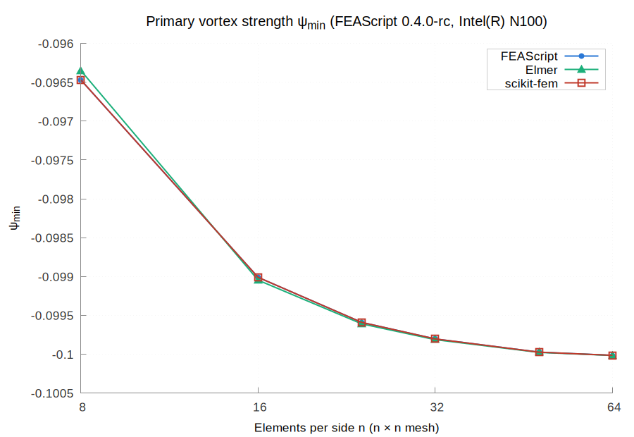
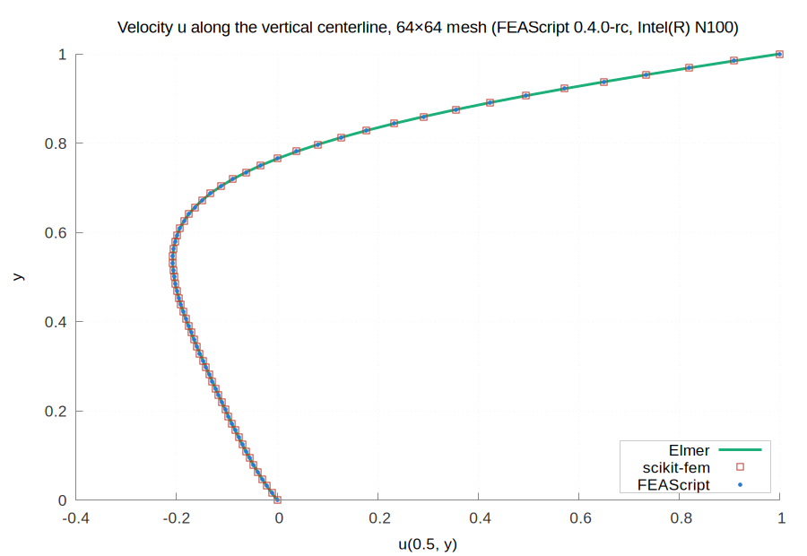
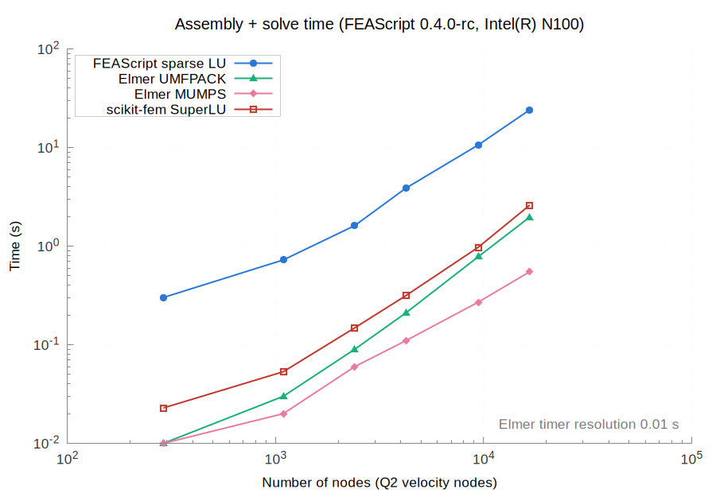
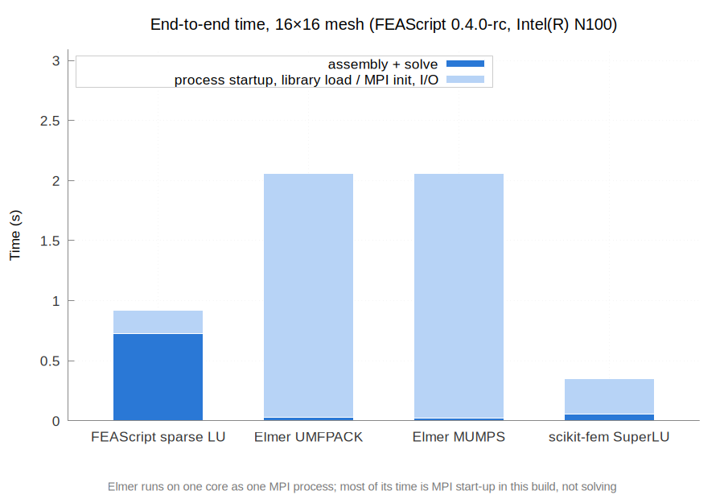
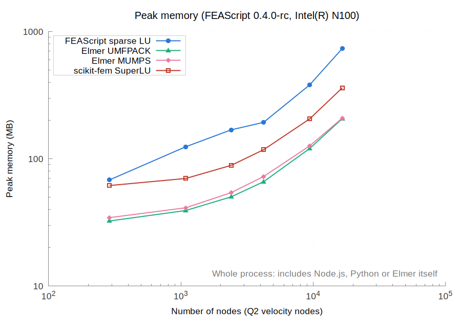
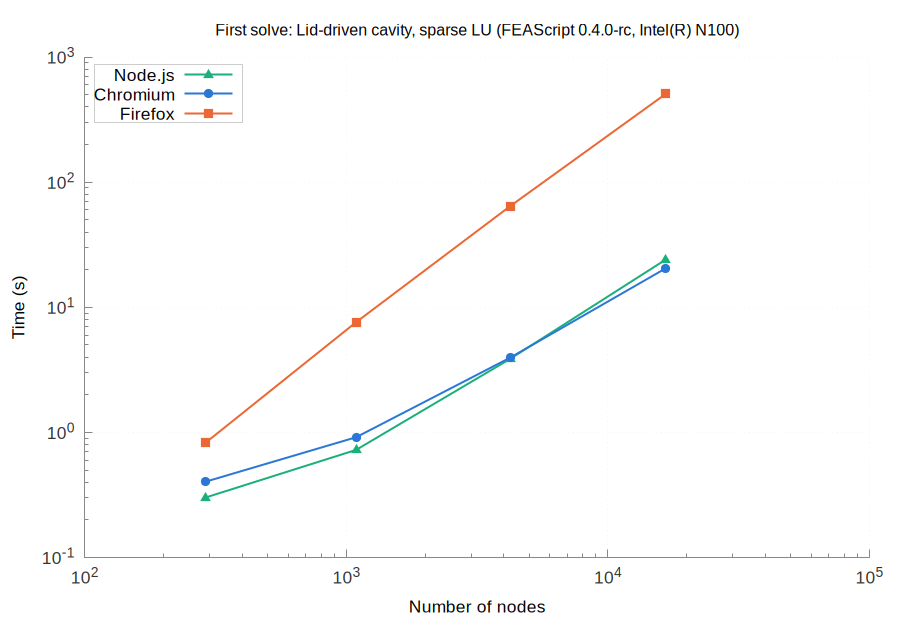
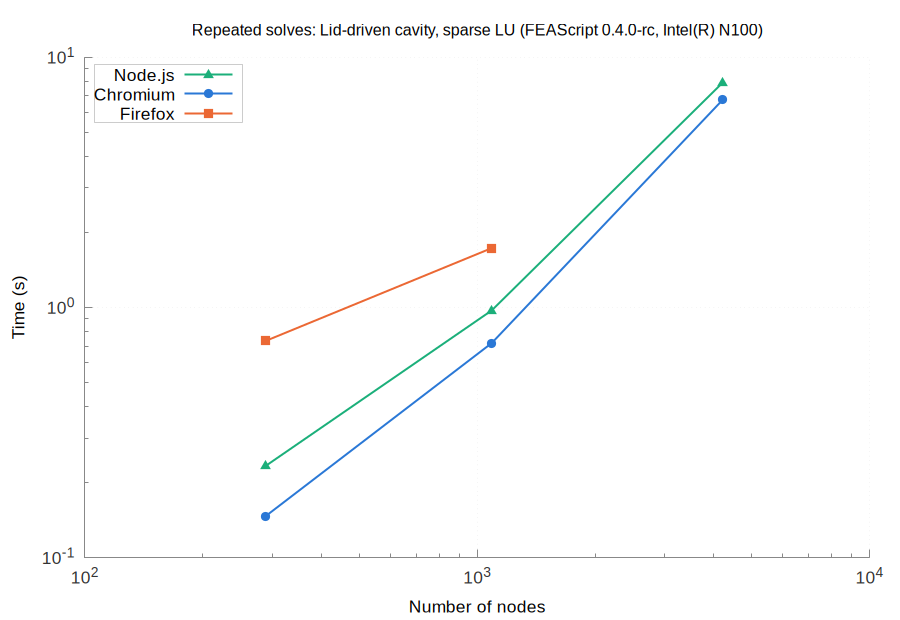

# Results for FEAScript 0.4.0-rc on Intel(R) N100

| | |
|---|---|
| FEAScript version | 0.4.0-rc |
| FEAScript commit | 367d095 |
| Released | not released |
| Loaded from | `dist/feascript.esm.js` |
| Elmer | 26.2 |
| scikit-fem | 12.0.2 (SciPy 1.18.1, NumPy 2.5.4, Python 3.12.3) |
| Node | v18.19.1 |
| Machine | Intel(R) N100, 7.5 GB RAM (Linux Mint 22.3, Linux 7.0.0-42-generic) |
| Cores | taskset -c 0, OMP_NUM_THREADS=1, OPENBLAS_NUM_THREADS=1 |
| Repeats | median of 5 fresh processes |
| Run on | 2026-11-06 |

All the numbers are in [results_table.md](results_table.md) and [results.json](results.json).

On every mesh it solved, FEAScript's primary vortex strength ψ_min matches Elmer's (UMFPACK) to within 1.2e-04.

At the nodes farther than 0.2 from the two lid corners, the velocities of the two codes differ by at most 4.9e-05 on the 64×64 mesh, against 8.0e-02 on the 8×8 mesh, so both converge to the same solution. Next to the lid corners they differ by up to 0.17 on every mesh: there FEAScript applies the full lid velocity along the top edge of the corner element, while Elmer interpolates it linearly from the corner, where the velocity is 0.

scikit-fem sets the lid velocity the same way as FEAScript, so the two are compared directly at all their nodes, lid corners included: on every mesh the velocities differ by at most 3.7e-13 and the pressures, at the mesh vertices, by at most 4.9e-10.

## Primary vortex strength

## Centerline velocity

## Assembly and solve time

## End-to-end time

## Peak memory

## Browsers

Chromium 156.0.8078.79, Firefox 159.0, each run in a fresh headless browser on one core, with FEAScript on the main thread of the page. The first solve in a fresh process on the largest mesh of each case, with the slowdown against Node.js:

| Case | Nodes | Node.js | Chromium | Firefox |
|---|---|---|---|---|
| Lid-driven cavity, sparse LU | 16,641 | 24.11 s | 20.52 s (0.9×) | 508.77 s (21.1×) |

The solutions of the browsers differ from those of Node.js by at most 0.0e+00.

