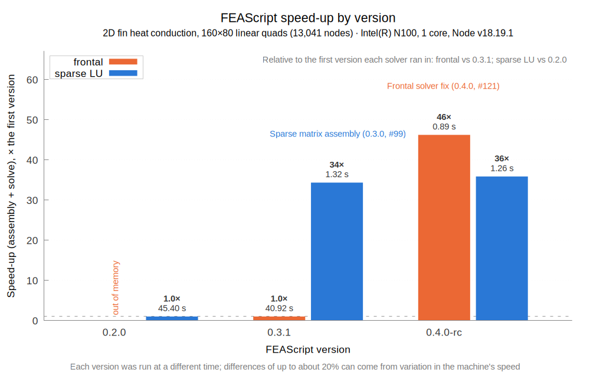

# FEAScript vs Elmer benchmark

This folder compares [FEAScript](https://feascript.com/) with the [Elmer](https://www.elmerfem.org/) finite element solver on the same problem, the 2D fin from the [FEAScript-core examples](https://github.com/FEAScript/FEAScript-core/tree/main/examples). Both codes solve it on identical meshes and are compared on accuracy and on run time. Each machine and FEAScript version gets its own set of results, so the comparison can be repeated as FEAScript develops.

## Contents

- [Results](#results)
- [The problem](#the-problem)
- [What is measured](#what-is-measured)
- [How to run the benchmark](#how-to-run-the-benchmark)
- [License](#license)

## Results

The results are in `results/<machine>/<version>/`:

| Machine | FEAScript version | Results |
|---|---|---|
| Intel N100 | 0.2.0 | [results/intel-n100/0.2.0/](results/intel-n100/0.2.0/) |
| Intel N100 | 0.3.1 | [results/intel-n100/0.3.1/](results/intel-n100/0.3.1/) |
| Intel N100 | 0.4.0-rc | [results/intel-n100/0.4.0-rc/](results/intel-n100/0.4.0-rc/) |

FEAScript's speed-up on the 160×80 linear mesh by version, with the assembly and solve time of each run, on the Intel N100:



📖 Each results folder has a README with the plots of that run, a table of all the numbers (`results_table.md`) and the details of the run (`meta.json`): the FEAScript version and commit, the versions of the other software, the machine and the date.

> **About the comparison:** Elmer runs here on one core, as a single MPI process, on small 2D problems, so that both codes are compared on the same terms. Elmer is a parallel code built for much larger problems, and this setup does not show its parallel performance. Its end-to-end time includes about 2 s of MPI start-up in the build used here. See [About the comparison](../README.md#about-the-comparison).

## The problem

- **Domain:** 4 × 2 rectangle, thermal conductivity k = 1
- **Constant temperature:** T = 200 at the bottom and right edges
- **Symmetry:** zero heat flux on the left edge
- **Convection:** h = 1 and T∞ = 20 on the top edge
- **Exact solution:** T = 200 + Σ Aₙ cos(λₙx) sinh(λₙy) with λₙ = (2n−1)π/8, evaluated to better than 1e-6 and used as the reference

## What is measured

Both codes solve the problem on the same structured quadrilateral meshes:

- **Linear (4-node) elements:** 20×10, 40×20, 80×40, 160×80 and 320×160, plus 77×39 for the end-to-end time
- **Quadratic (9-node) elements:** 10×5, 20×10, 40×20, 80×40 and 160×80

The meshes have 231 to 51,681 nodes. On each mesh, the benchmark runs:

- **FEAScript:** the `frontal` and `lusolve` solvers, loaded from the built bundle `dist/feascript.esm.js` as npm and browser users load it, in Node
- **Elmer:** the BiCGStab (with ILU0), UMFPACK and MUMPS solvers, with 1 steady-state and 1 nonlinear iteration since the problem is linear. ElmerGrid generates the meshes

And compares:

- **Accuracy:** the nodal temperatures of each code against the exact solution (RMS and max error) and against each other
- **Assembly and solve time:**
  - FEAScript: the time of `model.solve()`, which includes mesh generation
  - Elmer: the `Solver time` of HeatSolver, at 0.01 s resolution
- **End-to-end time:** the wall time of the whole process, from start to exit
  - FEAScript: also includes starting Node and loading FEAScript
  - Elmer: also includes reading the `.sif` and mesh files, and starting MPI in an MPI-enabled build

To keep the comparison fair, every timed process is pinned to one core (`taskset -c 0`, `OMP_NUM_THREADS=1`, `OPENBLAS_NUM_THREADS=1`), and each time is the median of several fresh processes. A run that runs out of memory or exceeds the time limit is recorded as such.

Notes on reading the times:

- **Browsers:** the benchmark runs in Node, which uses the same V8 JavaScript engine as Chrome and other Chromium-based browsers. Browsers with other engines, such as Firefox, can be slower
- **Comparing versions:** each version is benchmarked at a different time, and the speed of the machine varies over time, by up to about 20% on the Intel N100. Smaller differences between versions in the history plot are within this variation
- **JIT warm-up:** each FEAScript time comes from a fresh process, so it includes JIT warm-up. Repeats inside the same process are in the `warmWall` column

## How to run the benchmark

The benchmark needs Node.js, Python 3 with NumPy, gnuplot, and ElmerSolver and ElmerGrid on the `PATH`. It benchmarks the [FEAScript-core](https://github.com/FEAScript/FEAScript-core) checkout next to this repository (`../../FEAScript-core` from this folder). Build it first with `npm run build`, since the benchmark loads `dist/feascript.esm.js`.

```
python3 benchmark.py                          # writes results/<machine>/<version>/
python3 make_report.py <machine> <version>    # writes the plots, results_table.md and README.md
python3 ../make_history.py heatConduction2DFin  # updates the plots of FEAScript's speed-up by version in history/<machine>/
```

The machine defaults to a name made from the CPU model, e.g. `intel-n100`, and the version to the `version` field of `FEAScript-core/package.json`. These environment variables change the run:

- **`FEASCRIPT_MACHINE`:** the name of the machine folder

- **`FEASCRIPT_CORE`:** the path of another FEAScript-core checkout, e.g. a released version
- **`FEASCRIPT_VERSION`:** the name of the results folder, e.g. `FEASCRIPT_VERSION=0.4.0`
- **`FEASCRIPT_COMMIT` and `FEASCRIPT_RELEASE_DATE`:** the commit and release date to record, when `FEASCRIPT_CORE` is not a git checkout
- **`FEASCRIPT_ENTRY=src`:** loads the source files instead of the built bundle
- **`CORE_ID`:** the CPU core to pin the runs to (default 0)
- **`REPS` and `WARM`:** the number of repeats and warm repeats
- **`FEA_TIMEOUT`:** the time limit of a FEAScript process, in seconds
- **`RESUME=1`:** keeps the meshes already in `results.json` and runs only the missing ones
- **`ONLY`:** runs a single case, e.g. `ONLY=linear-77x39`

After a run, add a row to [Results](#results) and run `make_history.py`, which picks up every folder in `results/`. Use `--case` to plot another mesh, e.g. `python3 ../make_history.py heatConduction2DFin --case quadratic-80x40`.

The files in this folder:

- **`benchmark.py`:** runs both codes, compares them and writes the results
- **`make_report.py`:** draws the plots and writes the results table and README of a run
- **`run_feascript.mjs`:** runs one FEAScript case
- **`case.sif.in`:** the Elmer input template
- **`results/meshes/`:** ElmerGrid meshes, shared by all runs and not committed
- **`results/<machine>/<version>/work/`:** Elmer `.sif` files and FEAScript nodal results (the nodal results are not committed)

## License

This benchmark is released under the [MIT license](../LICENSE). Note that the core library of FEAScript is distributed under the terms of the [MIT license](https://github.com/FEAScript/FEAScript-core/blob/main/LICENSE).
