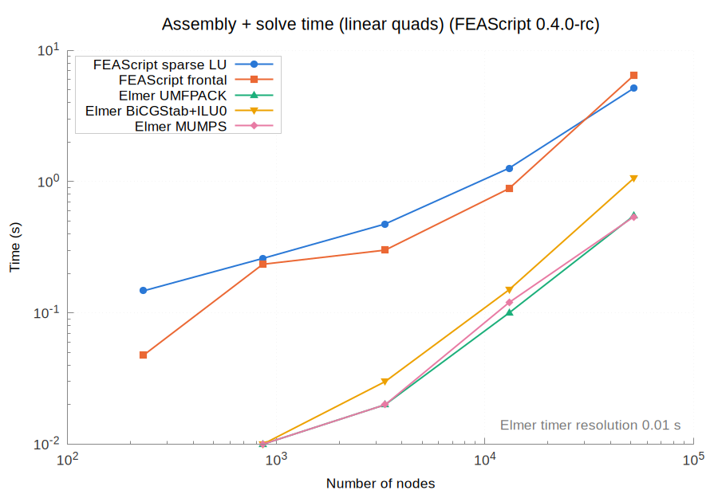
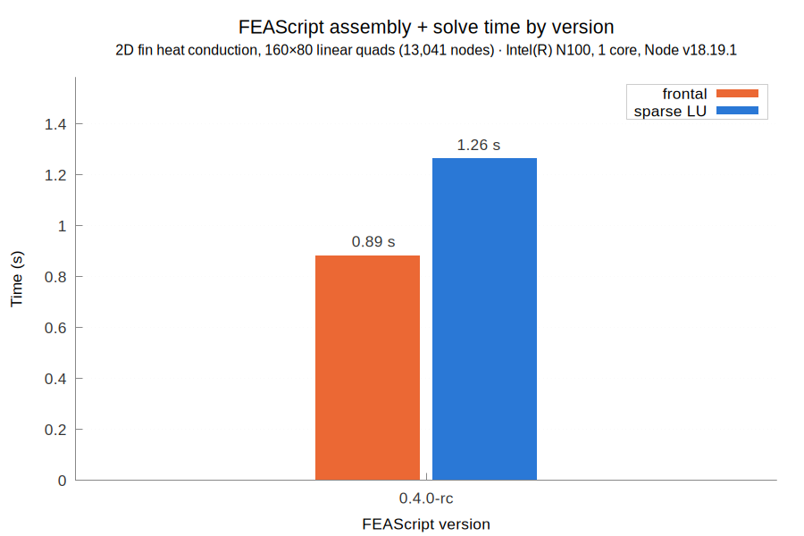
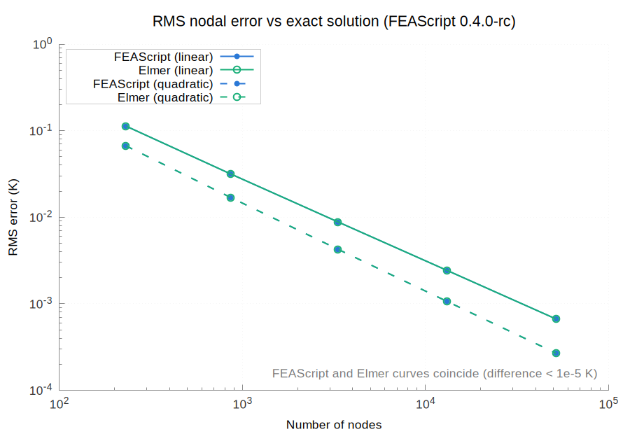
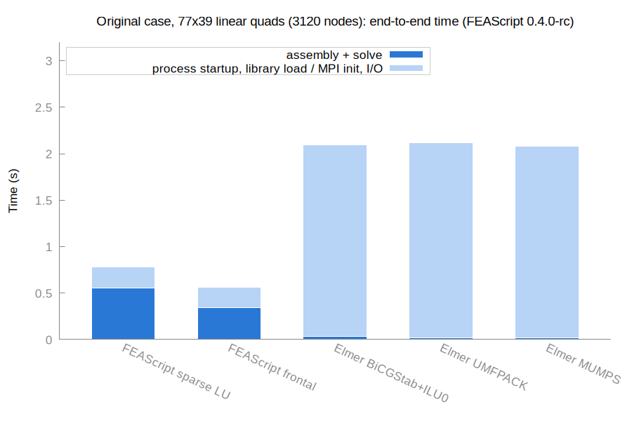

# FEAScript vs Elmer benchmark

This folder compares [FEAScript](https://feascript.com/) with the [Elmer](https://www.elmerfem.org/) finite element solver on the same problem, the 2D fin from the [FEAScript-core examples](https://github.com/FEAScript/FEAScript-core/tree/main/examples). Both codes solve it on identical meshes and are compared on accuracy and on run time. Each FEAScript version gets its own set of results, so the comparison can be repeated as FEAScript develops.



## Contents

- [Results by version](#results-by-version)
- [The problem](#the-problem)
- [Setup](#setup)
- [Results for 0.4.0-rc](#results-for-040-rc)
- [How to run the benchmark](#how-to-run-the-benchmark)
- [License](#license)

## Results by version

| FEAScript version | Date | Results |
|---|---|---|
| 0.4.0-rc | 2026-11-04 | [results/0.4.0-rc/](results/0.4.0-rc/) |

FEAScript's assembly and solve time on the 160×80 linear mesh, for each version:



## The problem

- **Domain:** 4 × 2 rectangle, thermal conductivity k = 1
- **Constant temperature:** T = 200 at the bottom and right edges
- **Symmetry:** zero heat flux on the left edge
- **Convection:** h = 1 and T∞ = 20 on the top edge
- **Exact solution:** T = 200 + Σ Aₙ cos(λₙx) sinh(λₙy) with λₙ = (2n−1)π/8, evaluated to better than 1e-6 K and used as the reference

## Setup

- **Machine:** Intel N100 (4 cores), Linux
- **FEAScript:** the built bundle `dist/feascript.esm.js`, as loaded by npm and browser users, run in Node v18.19.1 (V8). The exact commit is in each version's `meta.json`
- **Elmer:** ElmerSolver 26.2 (MPI-enabled build), with meshes generated by ElmerGrid
- **One core:** every timed process is pinned to one core (`taskset -c 0`, `OMP_NUM_THREADS=1`, `OPENBLAS_NUM_THREADS=1`)
- **Meshes:** identical structured quadrilateral meshes in both codes, from 231 to 51,681 nodes
  - Linear (4-node) elements: 20×10 to 320×160, plus the 77×39 mesh of the [2025 run](https://github.com/FEAScript/FEAScript-assets/tree/main/runs/elmer_comparison)
  - Quadratic (9-node) elements: 10×5 to 160×80
- **Repeats:** median of 5 fresh processes for each configuration
- **FEAScript solvers:** `frontal` and `lusolve` (math.js sparse LU)
- **Elmer solvers:** BiCGStab with ILU0, UMFPACK and MUMPS. All Elmer runs use 1 steady-state iteration and 1 nonlinear iteration, since the problem is linear

Two times are recorded for each run:

- **Assembly + solve:**
  - FEAScript: the time of `model.solve()`, which includes mesh generation
  - Elmer: the `Solver time` of HeatSolver, at 0.01 s resolution
- **Process:** the wall time of the whole process
  - FEAScript: also includes Node start-up and loading FEAScript
  - Elmer: also includes MPI start-up and reading the `.sif` and mesh files. It excludes ElmerGrid, which takes about 0.01 s

## Results for 0.4.0-rc

All numbers are in [results/0.4.0-rc/results_table.md](results/0.4.0-rc/results_table.md), and the run details are in [meta.json](results/0.4.0-rc/meta.json).

### Accuracy

On every mesh, FEAScript's nodal temperatures match Elmer's to within **5e-6 K**, which is the precision of Elmer's text output. FEAScript's frontal and sparse LU solvers give the same values.

Both codes have the same error against the exact solution:

| Elements | Nodes | RMS error | Max error |
|---|---|---|---|
| Linear | 3k | 8.8e-3 K | 0.31 K |
| Linear | 51k | 6.7e-4 K | 0.081 K |
| Quadratic | 51k | 2.7e-4 K | 0.049 K |

The RMS error converges at O(h²) for both element orders, and the max error at O(h). Both rates are limited by the corner at (4, 2), where the convective edge meets the constant-temperature edge.



### Assembly and solve time

Elmer is about **9–15× faster** than FEAScript's faster solver at every mesh size:

| Mesh (nodes) | FEAScript frontal | FEAScript sparse LU | Elmer UMFPACK | Elmer MUMPS | Elmer BiCGStab |
|---|---|---|---|---|---|
| 80×40 linear (3,321) | 0.30 s | 0.48 s | 0.02 s | 0.02 s | 0.03 s |
| 160×80 linear (13,041) | 0.89 s | 1.27 s | 0.10 s | 0.12 s | 0.15 s |
| 320×160 linear (51,681) | 6.44 s | 5.14 s | 0.55 s | 0.54 s | 1.06 s |
| 40×20 quadratic (3,321) | 0.38 s | 0.57 s | 0.03 s | 0.02 s | 0.03 s |
| 80×40 quadratic (13,041) | 0.79 s | 1.34 s | 0.10 s | 0.12 s | 0.16 s |
| 160×80 quadratic (51,681) | 4.93 s | 5.79 s | 0.64 s | 0.50 s | 1.19 s |

FEAScript's frontal solver is faster up to 13k nodes. At 51k nodes on the linear mesh, sparse LU is faster.


### End-to-end time on the 2025 case

On the 77×39 mesh of the 2025 run (3,120 nodes), **FEAScript finishes first end to end**:

| | Assembly + solve | Whole process |
|---|---|---|
| FEAScript frontal | 0.35 s | 0.56 s |
| FEAScript sparse LU | 0.55 s | 0.78 s |
| Elmer UMFPACK | 0.02 s | 2.12 s |
| Elmer MUMPS | 0.02 s | 2.08 s |
| Elmer BiCGStab | 0.03 s | 2.09 s |

Elmer solves this mesh in 0.02 s but spends about 2 s starting OpenMPI, which its MPI-enabled build does even for a serial run. FEAScript loads in under 0.1 s from the built bundle. Small problems are therefore faster with FEAScript, and large ones with Elmer.



### Frontal solver fix

Version 0.4.0-rc includes the frontal solver fix for [#121](https://github.com/FEAScript/FEAScript-core/issues/121). Before the fix, the solver had two problems:

- **Dense front:** the front was allocated as a dense N × N array
- **Slow elimination:** it eliminated at most one node per assembled element, so the front kept growing

It now eliminates every fully summed node before assembling the next element, sizes the front from a prefront pass and stores it in typed arrays. Assembly and solve time on the same benchmark, measured with FEAScript loaded from its source files:

| Mesh | Before the fix | After the fix |
|---|---|---|
| 77×39 linear (3.1k nodes) | 0.79 s | 0.27 s |
| 160×80 linear (13k nodes) | 30.9 s | 0.92 s |
| 40×20 quadratic (3.3k nodes) | 22.2 s | 0.33 s |
| 80×40 quadratic (13k nodes) | out of memory | 0.78 s |

### Notes

- **Browsers:** the benchmark runs in Node, whose V8 engine is also used by Chromium. Firefox was 2–6× slower in the 2025 run
- **JIT warm-up:** each FEAScript time comes from a fresh process, so it includes JIT warm-up. Repeats inside the same process are faster on small meshes and about the same on large ones (the `warmWall` column)

## How to run the benchmark

The benchmark needs Node.js, Python 3 with NumPy, gnuplot, and ElmerSolver and ElmerGrid on the `PATH`. It benchmarks the [FEAScript-core](https://github.com/FEAScript/FEAScript-core) checkout next to this repository (`../../FEAScript-core` from this folder). Build it first with `npm run build`, since the benchmark loads `dist/feascript.esm.js`.

```
python3 benchmark.py               # about 20 minutes, writes results/<version>/
python3 make_report.py <version>   # writes the plots and results_table.md in results/<version>/
python3 make_history.py            # updates the plot of FEAScript's time by version in history/
```

The version defaults to the `version` field of `FEAScript-core/package.json`. These environment variables change the run:

- **`FEASCRIPT_CORE`:** the path of another FEAScript-core checkout
- **`FEASCRIPT_VERSION`:** the name of the results folder, e.g. `FEASCRIPT_VERSION=0.4.0`
- **`FEASCRIPT_ENTRY=src`:** loads the source files instead of the built bundle
- **`REPS` and `WARM`:** the number of repeats and warm repeats
- **`ONLY`:** runs a single case, e.g. `ONLY=linear-77x39`

After a run, add a row to [Results by version](#results-by-version) and run `make_history.py`, which picks up every folder in `results/`. Use `--case` to plot another mesh, e.g. `python3 make_history.py --case quadratic-80x40`.

📖 Each run records `meta.json`, with the FEAScript version and commit, the Elmer and Node versions, the CPU, the date and the core pinning.

The files in this folder:

- **`benchmark.py`:** runs both codes, compares them and writes the results
- **`make_report.py`:** draws the plots and the results table
- **`make_history.py`:** draws FEAScript's time by version, from all the results folders
- **`run_feascript.mjs`:** runs one FEAScript case
- **`case.sif.in`:** the Elmer input template
- **`results/meshes/`:** ElmerGrid meshes, shared by all versions and not committed
- **`results/<version>/work/`:** Elmer `.sif` files and FEAScript nodal results (the nodal results are not committed)

## License

This benchmark is released under the [MIT license](../LICENSE). Note that the core library of FEAScript is distributed under the terms of the [MIT license](https://github.com/FEAScript/FEAScript-core/blob/main/LICENSE).
