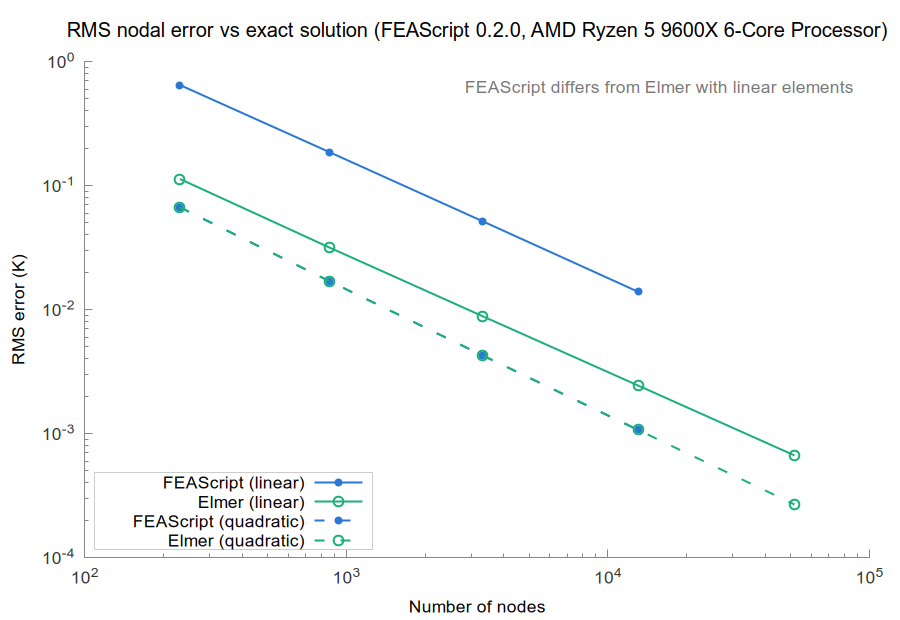
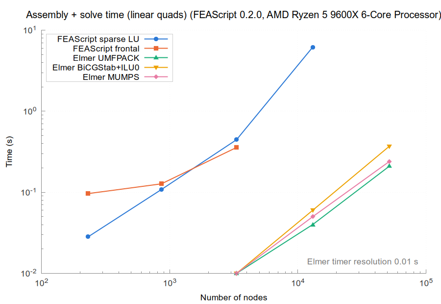
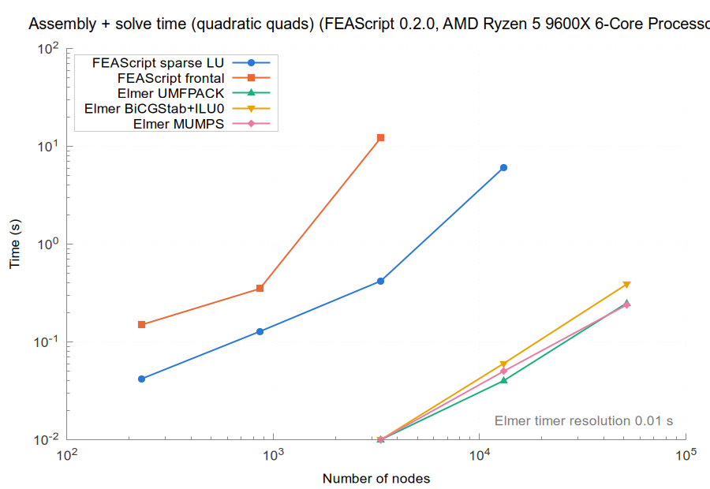
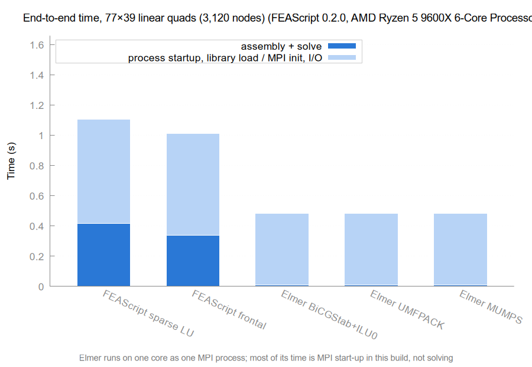
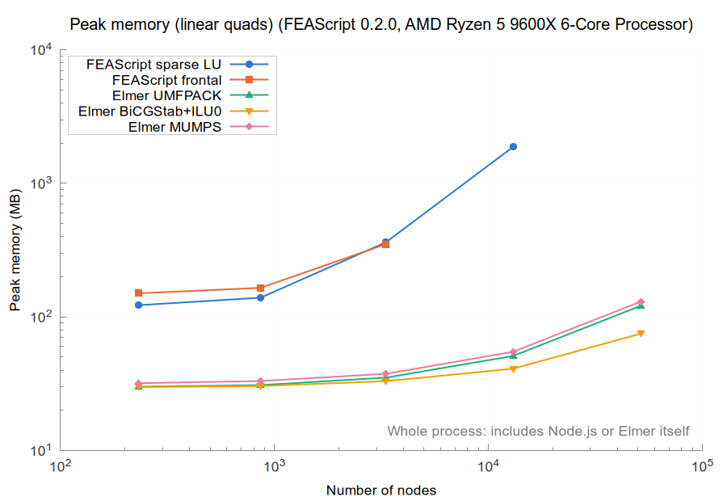
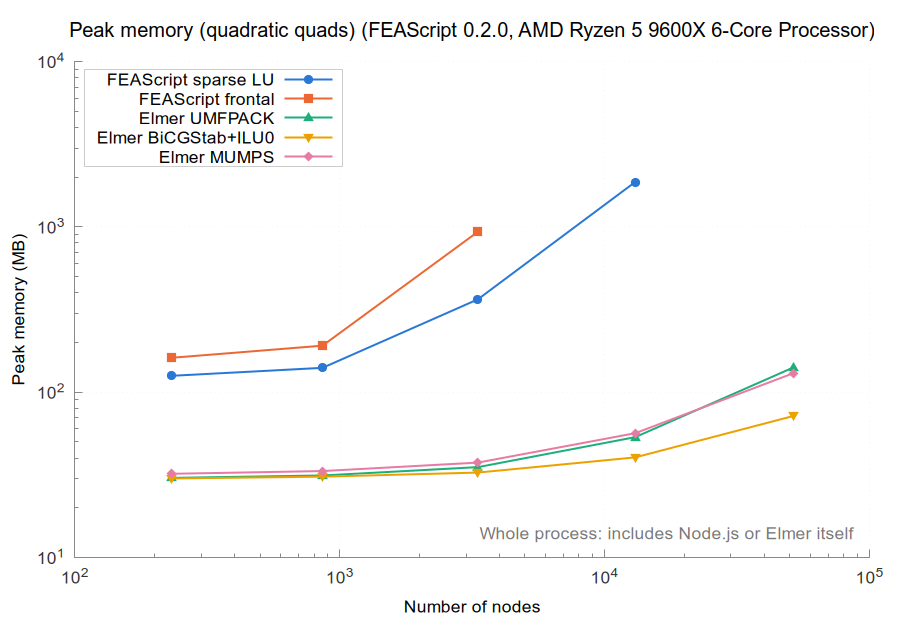

# Results for FEAScript 0.2.0 on AMD Ryzen 5 9600X 6-Core Processor

| | |
|---|---|
| FEAScript version | 0.2.0 |
| FEAScript commit | f526095 |
| Released | 2026-02-25 |
| Loaded from | `dist/feascript.esm.js` |
| Elmer | 26.2 (build of commit `56b16bd49`, 2026-11-02) |
| Node | v18.19.1 |
| Machine | AMD Ryzen 5 9600X 6-Core Processor, 14.7 GB RAM (Linux Mint 22.3, Linux 7.0.0-38-generic) |
| Cores | taskset -c 0, OMP_NUM_THREADS=1, OPENBLAS_NUM_THREADS=1 |
| Repeats | median of 5 fresh processes |
| Run on | 2026-11-04 |

All the numbers are in [results_table.md](results_table.md) and [results.json](results.json).

On every mesh it solved, FEAScript's nodal temperatures match Elmer's (UMFPACK) to within 5.1e+00.

Runs that could not be measured:

- **FEAScript frontal, linear-160x80:** out of memory
- **FEAScript frontal, linear-320x160:** out of memory
- **FEAScript sparse LU, linear-320x160:** out of memory
- **FEAScript frontal, quadratic-80x40:** out of memory
- **FEAScript frontal, quadratic-160x80:** out of memory
- **FEAScript sparse LU, quadratic-160x80:** out of memory

## Accuracy

## Assembly and solve time

## End-to-end time

## Peak memory

