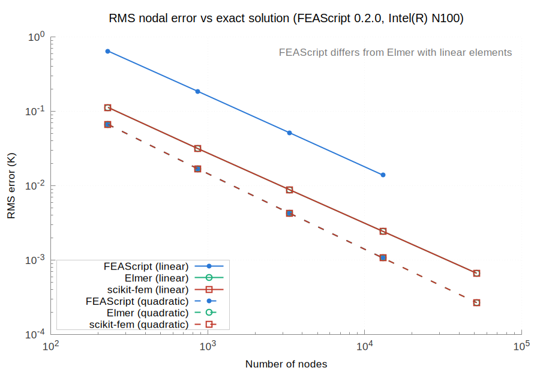
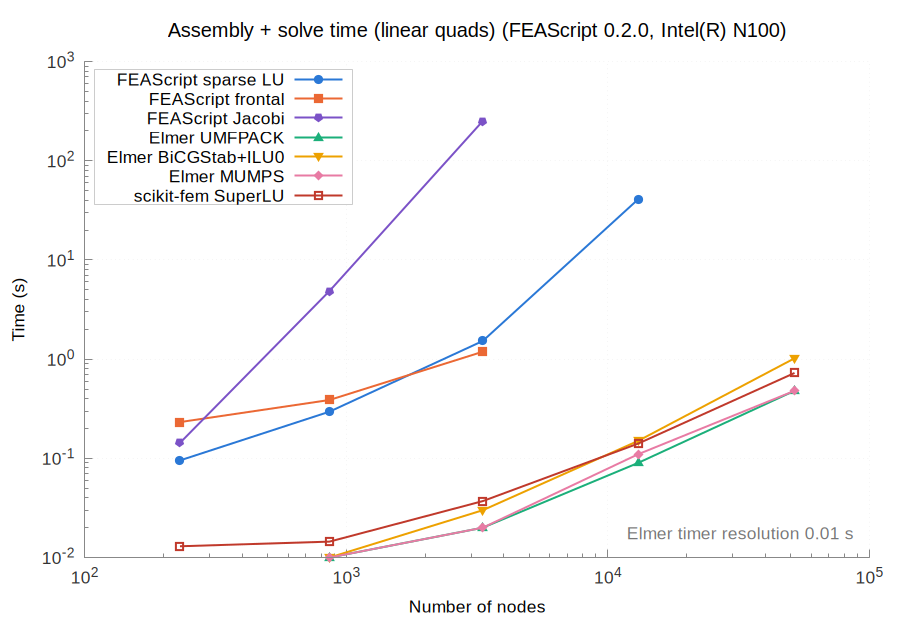
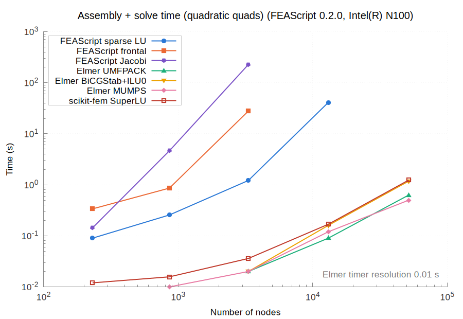
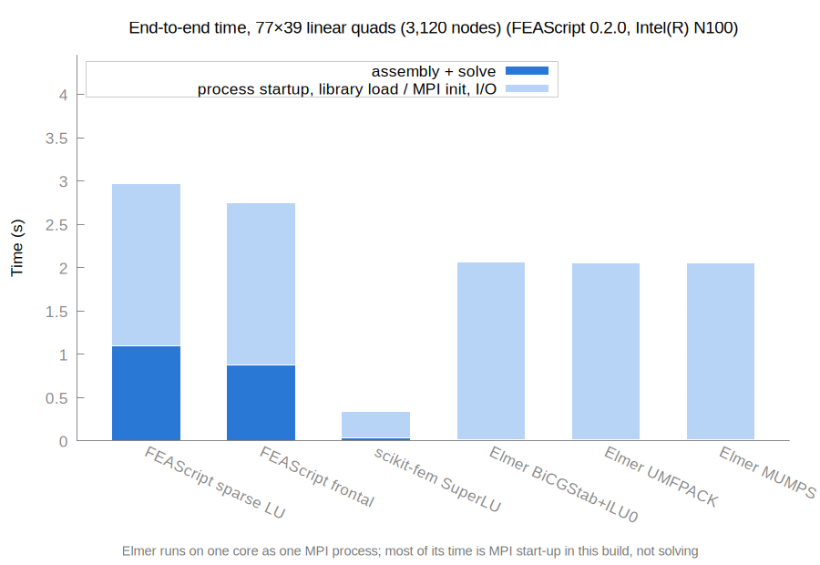
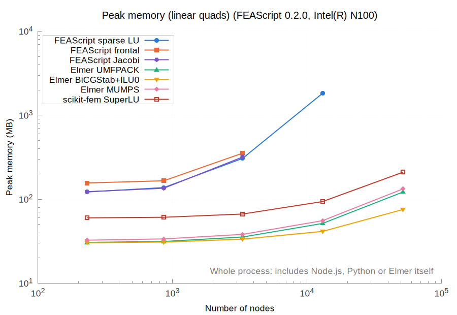
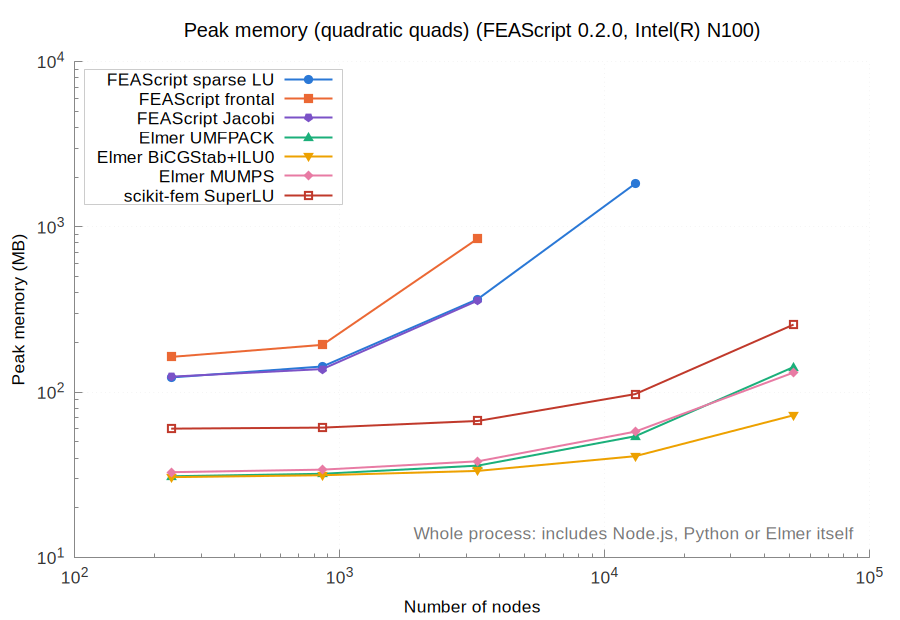

# Results for FEAScript 0.2.0 on Intel(R) N100

| | |
|---|---|
| FEAScript version | 0.2.0 |
| FEAScript commit | f526095 |
| Released | 2026-02-25 |
| Loaded from | `dist/feascript.esm.js` |
| Elmer | 26.2 |
| scikit-fem | 12.0.2 (SciPy 1.18.1, NumPy 2.5.4, Python 3.12.3) |
| Node | v18.19.1 |
| Machine | Intel(R) N100, 7.5 GB RAM (Linux Mint 22.3, Linux 7.0.0-42-generic) |
| Cores | taskset -c 0, OMP_NUM_THREADS=1, OPENBLAS_NUM_THREADS=1 |
| Repeats | median of 5 fresh processes |
| Run on | 2026-11-06 |

All the numbers are in [results_table.md](results_table.md) and [results.json](results.json).

On every mesh it solved, FEAScript's nodal temperatures match Elmer's (UMFPACK) to within 5.1e+00 with the direct solvers (`frontal` and `lusolve`).

scikit-fem's nodal temperatures match FEAScript's (`lusolve`) to within 5.1e+00 and Elmer's (UMFPACK) to within 5.0e-06.

Where the Jacobi solver converged (residual tolerance 1e-8 within 10,000 iterations), its temperatures match Elmer's to within 5.1e+00: it stops at a residual tolerance, so its error grows with the mesh.

Runs that could not be measured:

- **FEAScript frontal, linear-160x80:** out of memory
- **FEAScript Jacobi, linear-160x80:** timeout (> 600 s)
- **FEAScript frontal, linear-320x160:** out of memory
- **FEAScript sparse LU, linear-320x160:** out of memory
- **FEAScript Jacobi, linear-320x160:** out of memory
- **FEAScript Jacobi, linear-77x39:** not converged
- **FEAScript frontal, quadratic-80x40:** out of memory
- **FEAScript Jacobi, quadratic-80x40:** timeout (> 600 s)
- **FEAScript frontal, quadratic-160x80:** out of memory
- **FEAScript sparse LU, quadratic-160x80:** out of memory
- **FEAScript Jacobi, quadratic-160x80:** out of memory

Repeated solves not measured yet (a case with a first solve over 20 s used to be timed without one):

- **FEAScript Jacobi, linear-80x40**
- **FEAScript sparse LU, linear-160x80**
- **FEAScript frontal, quadratic-40x20**
- **FEAScript Jacobi, quadratic-40x20**
- **FEAScript sparse LU, quadratic-80x40**

## Accuracy

## Assembly and solve time

## End-to-end time

## Peak memory

