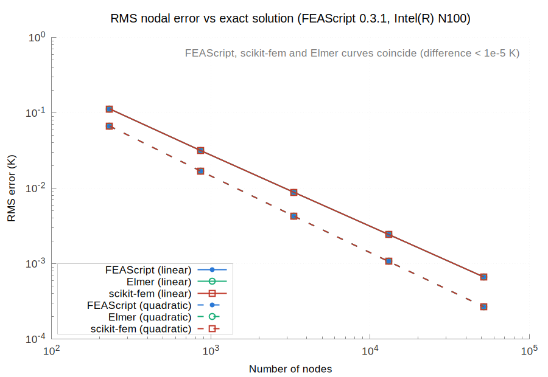
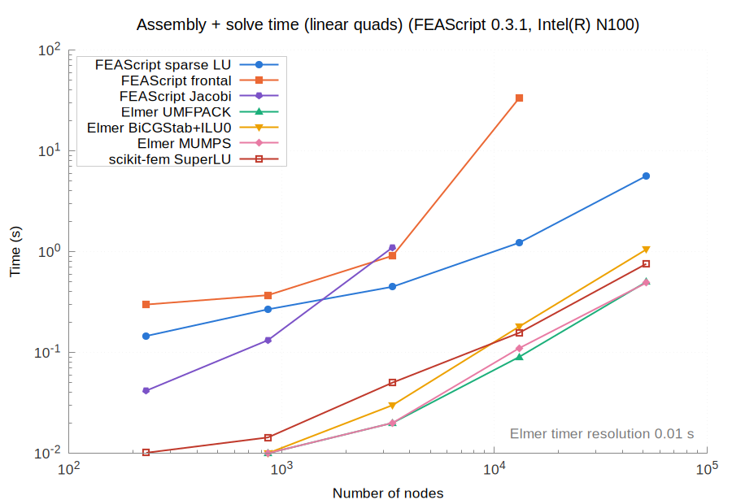
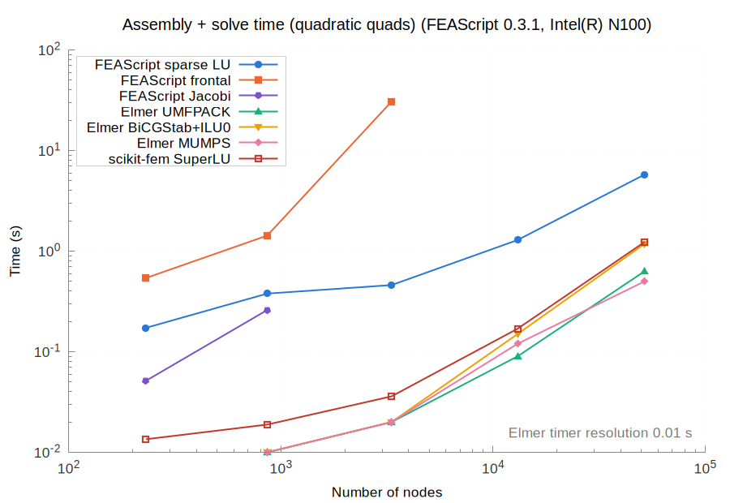
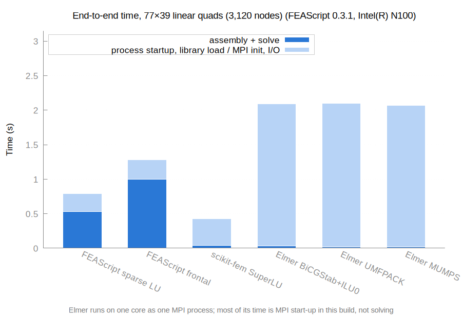
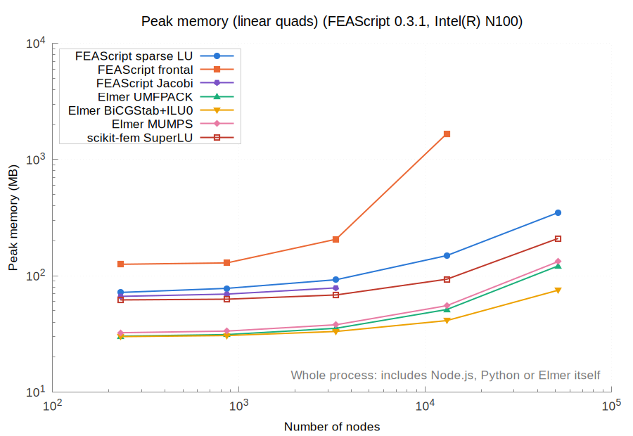
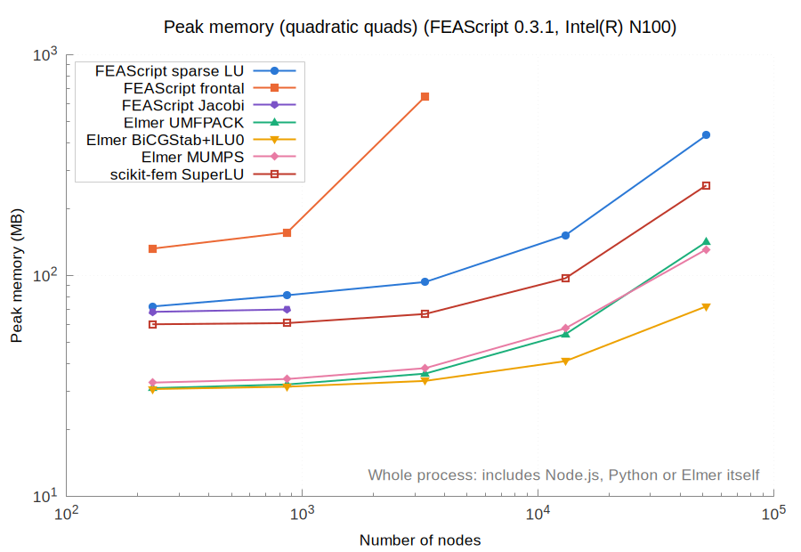
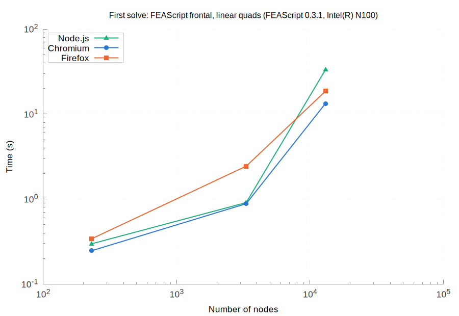
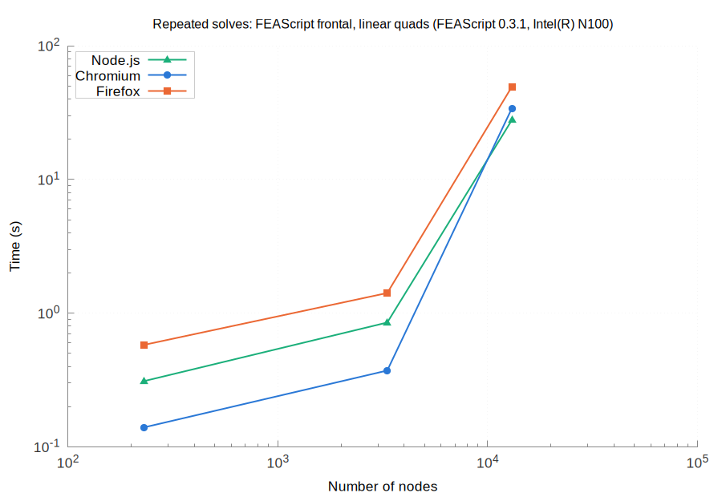
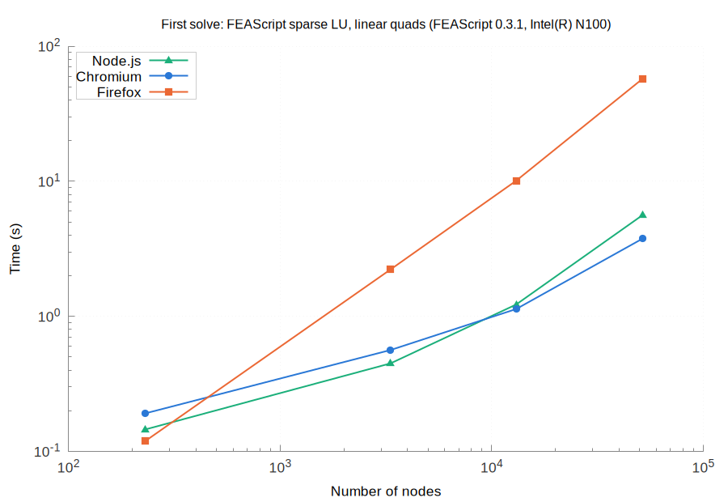
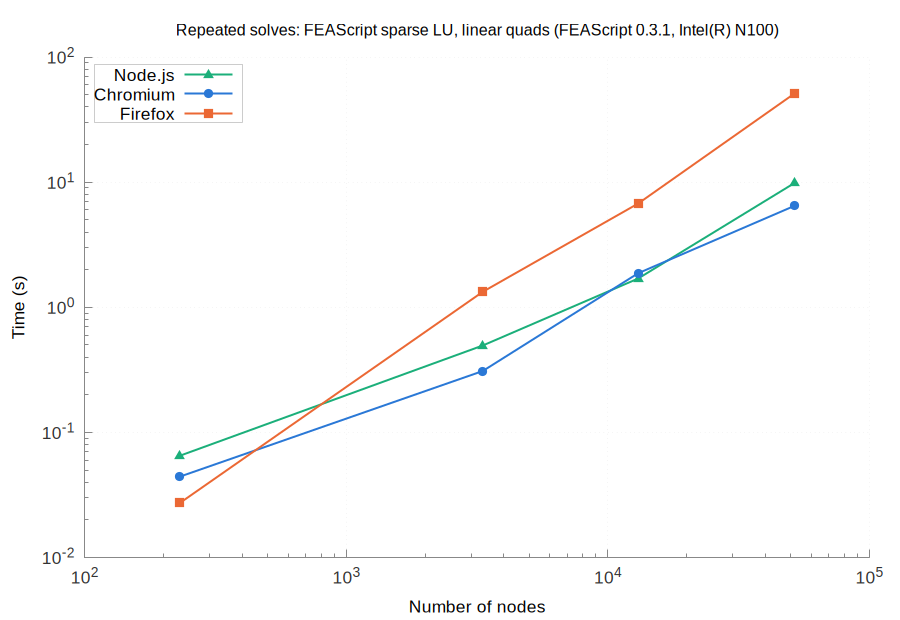

# Results for FEAScript 0.3.1 on Intel(R) N100

| | |
|---|---|
| FEAScript version | 0.3.1 |
| FEAScript commit | 083fc8c |
| Released | 2026-10-30 |
| Loaded from | `dist/feascript.esm.js` |
| Elmer | 26.2 |
| scikit-fem | 12.0.2 (SciPy 1.18.1, NumPy 2.5.4, Python 3.12.3) |
| Node | v18.19.1 |
| Machine | Intel(R) N100, 7.5 GB RAM (Linux Mint 22.3, Linux 7.0.0-42-generic) |
| Cores | taskset -c 0, OMP_NUM_THREADS=1, OPENBLAS_NUM_THREADS=1 |
| Repeats | median of 5 fresh processes |
| Run on | 2026-11-06 |

All the numbers are in [results_table.md](results_table.md) and [results.json](results.json).

On every mesh it solved, FEAScript's nodal temperatures match Elmer's (UMFPACK) to within 1.9e-10 with the direct solvers (`frontal` and `lusolve`).

scikit-fem's nodal temperatures match FEAScript's (`lusolve`) to within 1.8e-10 and Elmer's (UMFPACK) to within 1.5e-10.

Where the Jacobi solver converged (residual tolerance 1e-8 within 10,000 iterations), its temperatures match Elmer's to within 2.3e-03: it stops at a residual tolerance, so its error grows with the mesh.

Runs that could not be measured:

- **FEAScript Jacobi, linear-160x80:** not converged
- **FEAScript frontal, linear-320x160:** out of memory
- **FEAScript Jacobi, linear-320x160:** not converged
- **FEAScript Jacobi, quadratic-40x20:** not converged
- **FEAScript frontal, quadratic-80x40:** out of memory
- **FEAScript Jacobi, quadratic-80x40:** not converged
- **FEAScript frontal, quadratic-160x80:** out of memory
- **FEAScript Jacobi, quadratic-160x80:** not converged

## Accuracy

## Assembly and solve time

## End-to-end time

## Peak memory

## Browsers

Chromium 156.0.8078.79, Firefox 159.0, each run in a fresh headless browser on one core, with FEAScript on the main thread of the page. The first solve in a fresh process on the largest mesh of each case, with the slowdown against Node.js:

| Case | Nodes | Node.js | Chromium | Firefox |
|---|---|---|---|---|
| FEAScript frontal, linear quads | 13,041 | 33.21 s | 18.27 s (0.5×) | 57.71 s (1.7×) |
| FEAScript sparse LU, linear quads | 51,681 | 5.63 s | 4.04 s (0.7×) | 62.40 s (11.1×) |

The browsers give the same solutions as Node.js, bit for bit. Cases with a first solve over 20 s are timed once, with one repeated solve, instead of five times with three repeated solves. A case without a point on a plot was not measured, and each such case is listed in this report.

