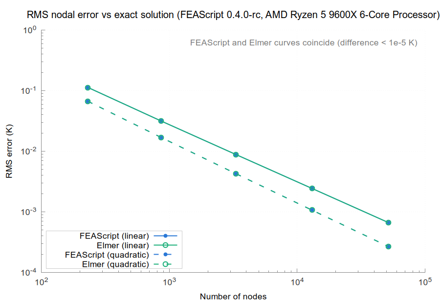
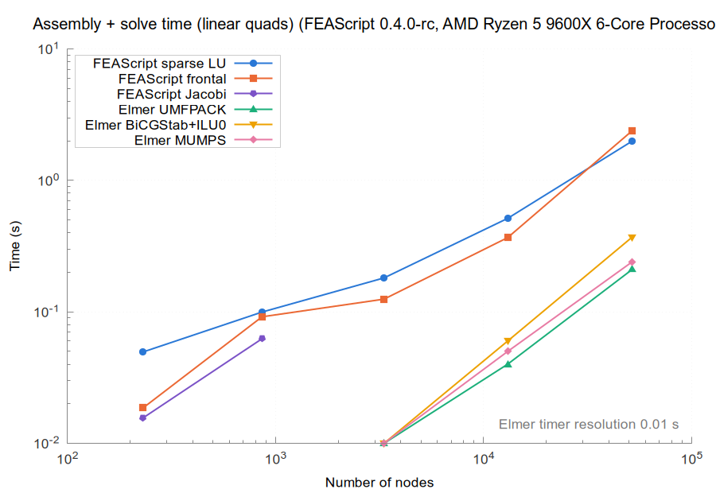
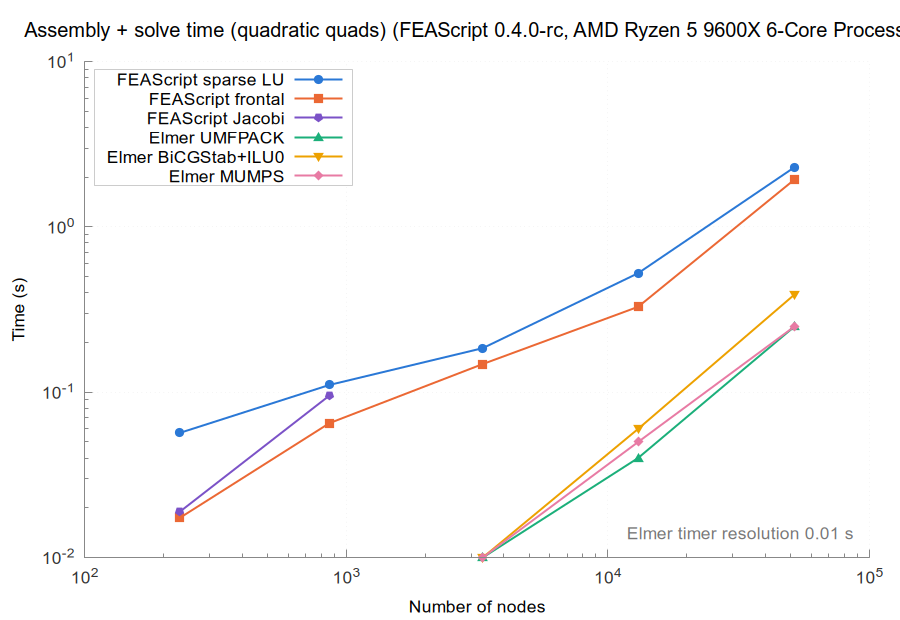
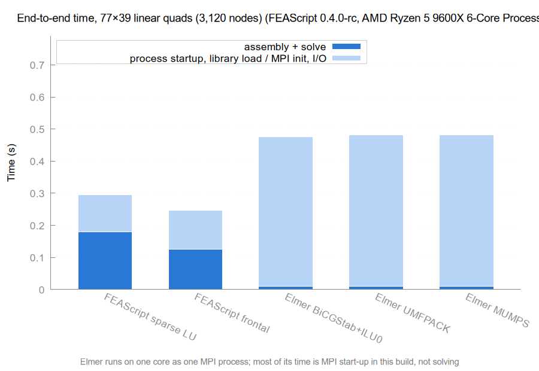
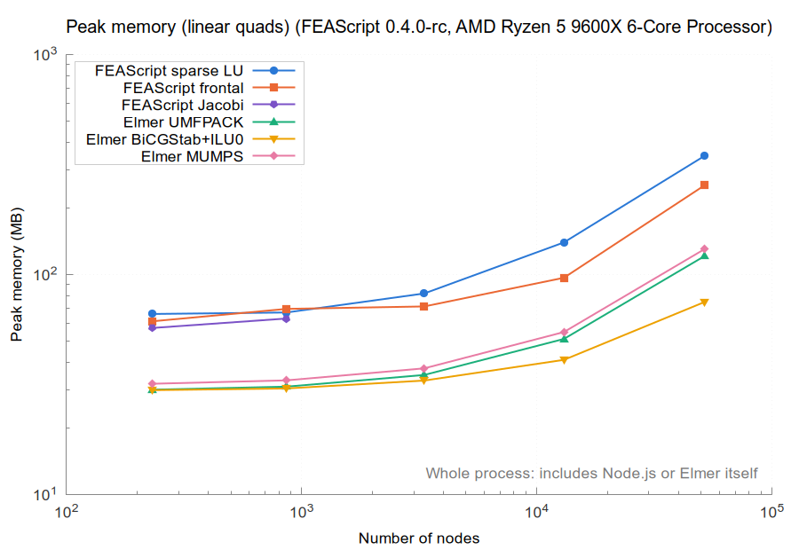
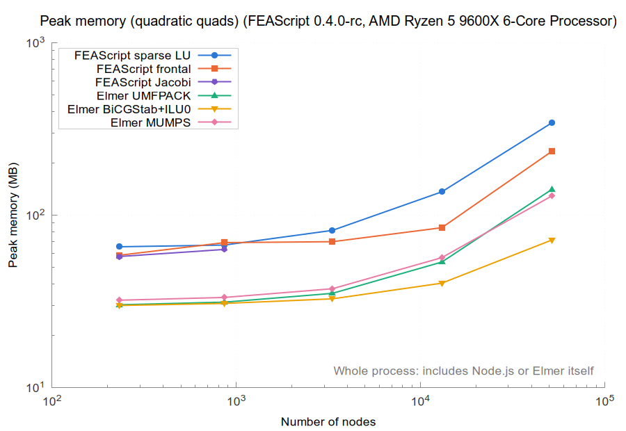

# Results for FEAScript 0.4.0-rc on AMD Ryzen 5 9600X 6-Core Processor

| | |
|---|---|
| FEAScript version | 0.4.0-rc |
| FEAScript commit | 395e064 |
| Released | not released |
| Loaded from | `dist/feascript.esm.js` |
| Elmer | 26.2-unknown |
| Node | v18.19.1 |
| Machine | AMD Ryzen 5 9600X 6-Core Processor, 14.7 GB RAM (Linux 7.0.0-38-generic) |
| Cores | taskset -c 0, OMP_NUM_THREADS=1, OPENBLAS_NUM_THREADS=1 |
| Repeats | median of 5 fresh processes |
| Run on | 2026-11-04 |
| Note | Benchmarked from the working tree before it was committed as 395e064 (#120, #132, #121 and the Jacobi log fix), with dist/ rebuilt from it |

All the numbers are in [results_table.md](results_table.md) and [results.json](results.json).

On every mesh it solved, FEAScript's nodal temperatures match Elmer's (UMFPACK) to within 5.0e-06 with the direct solvers (`frontal` and `lusolve`).

Where the Jacobi solver converged (residual tolerance 1e-8 within 10,000 iterations), its temperatures match Elmer's to within 1.9e-04: it stops at a residual tolerance, so its error grows with the mesh.

Runs that could not be measured:

- **FEAScript Jacobi, linear-80x40:** not converged
- **FEAScript Jacobi, linear-160x80:** not converged
- **FEAScript Jacobi, linear-320x160:** not converged
- **FEAScript Jacobi, quadratic-40x20:** not converged
- **FEAScript Jacobi, quadratic-80x40:** not converged
- **FEAScript Jacobi, quadratic-160x80:** not converged

## Accuracy

## Assembly and solve time

## End-to-end time

## Peak memory

