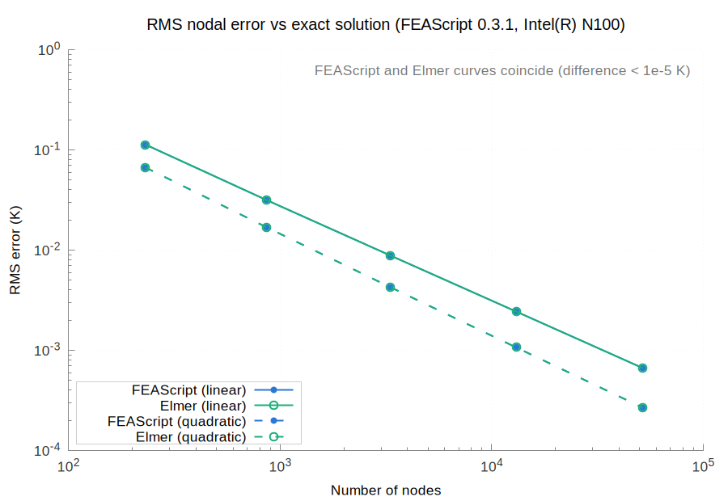
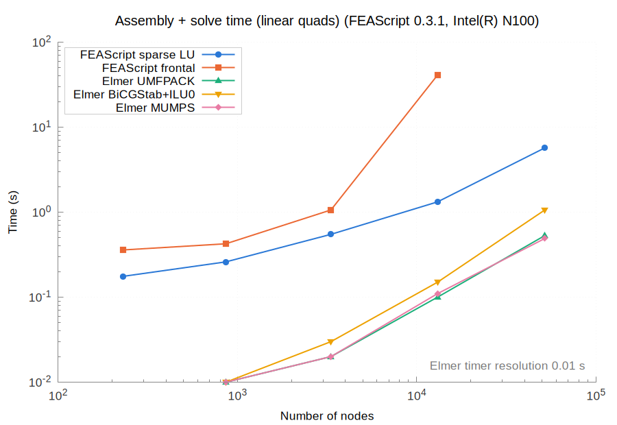
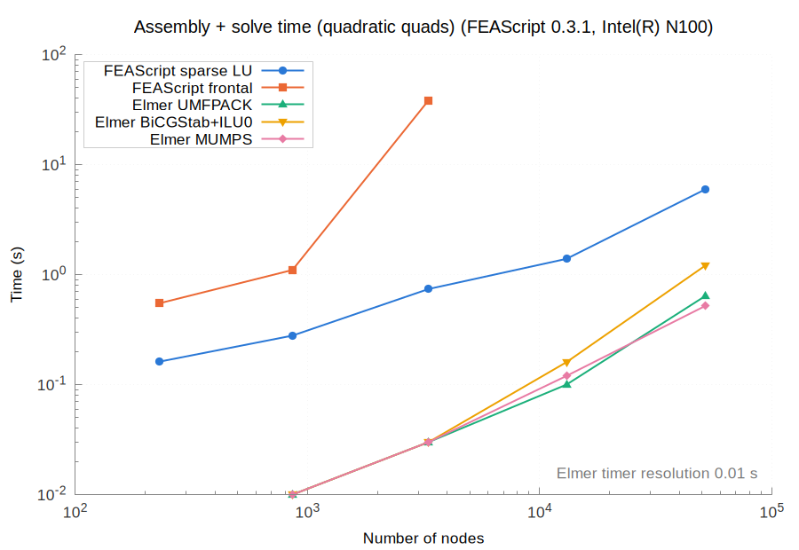
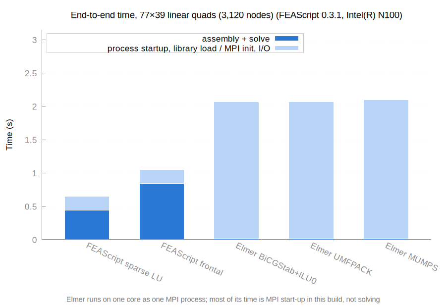

# Results for FEAScript 0.3.1 on Intel(R) N100

| | |
|---|---|
| FEAScript version | 0.3.1 |
| FEAScript commit | 083fc8c |
| Released | 2026-10-30 |
| Loaded from | `dist/feascript.esm.js` |
| Elmer | 26.2-unknown |
| Node | v18.19.1 |
| Machine | Intel(R) N100 (Linux 7.0.0-42-generic) |
| Cores | taskset -c 0, OMP_NUM_THREADS=1, OPENBLAS_NUM_THREADS=1 |
| Repeats | median of 5 fresh processes |
| Run on | 2026-11-04 |

All the numbers are in [results_table.md](results_table.md) and [results.json](results.json).

On every mesh it solved, FEAScript's nodal temperatures match Elmer's (UMFPACK) to within 5.0e-06.

Runs that could not be measured:

- **FEAScript frontal, linear-320x160:** out of memory
- **FEAScript frontal, quadratic-80x40:** out of memory
- **FEAScript frontal, quadratic-160x80:** out of memory

## Accuracy

## Assembly and solve time

## End-to-end time

