# Results for FEAScript 0.4.0 on Intel(R) N100

| | |
|---|---|
| FEAScript version | 0.4.0 |
| FEAScript commit | 367d095 |
| Released | not released |
| Loaded from | `dist/feascript.esm.js` |
| Elmer | 26.2 |
| scikit-fem | 12.0.2 (SciPy 1.18.1, NumPy 2.5.4, meshio 5.3.5, Python 3.12.3) |
| Gmsh | 4.12.1 |
| Node | v18.19.1 |
| Machine | Intel(R) N100, 7.5 GB RAM (Linux Mint 22.3, Linux 7.0.0-42-generic) |
| Cores | taskset -c 0, OMP_NUM_THREADS=1, OPENBLAS_NUM_THREADS=1 |
| Repeats | median of 5 fresh processes |
| Run on | 2026-11-06 |

All the numbers are in [results_table.md](results_table.md) and [results.json](results.json).

On every mesh it solved, with triangles and quadrilaterals, FEAScript's nodal temperatures match scikit-fem's to within 1.1e-10 when scikit-fem uses the same Gauss rules, and Elmer's (UMFPACK) to within 2.3e-11. The `frontal` and `lusolve` solvers agree to within 1.4e-10.

On distorted quadrilaterals these Gauss rules are not exact. With a much finer rule, scikit-fem's RMS error is lower than FEAScript's by 1.2% to 2.1%. On triangles the rules are exact, so the finer rule changes nothing.

## Accuracy

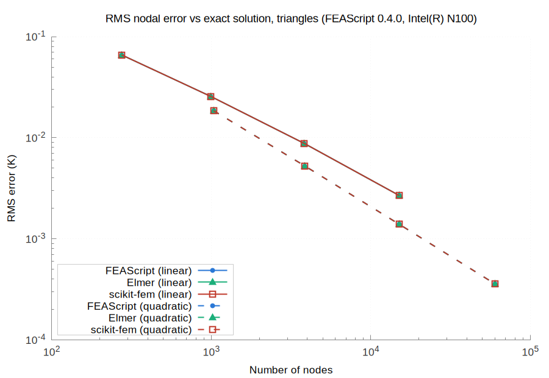
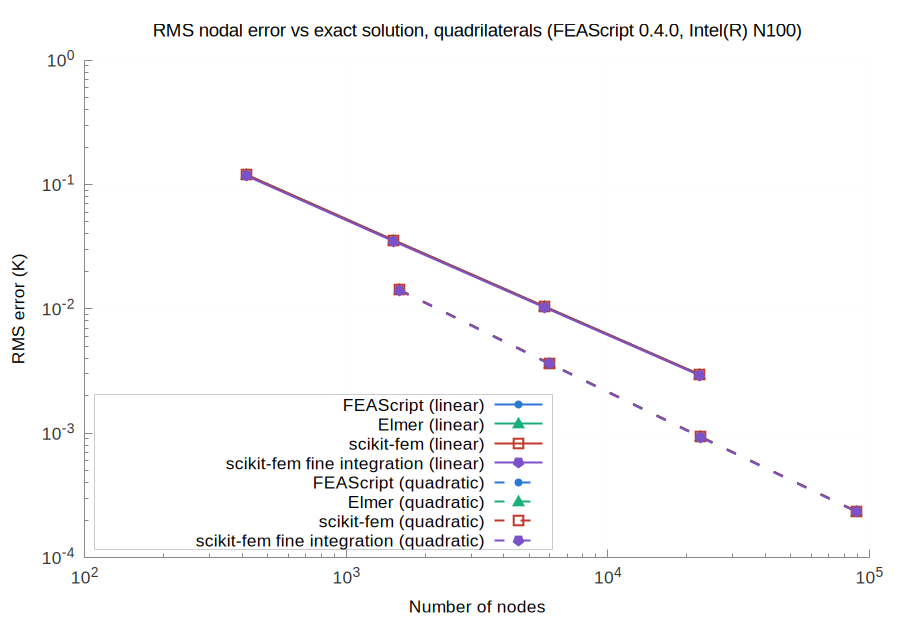

## Assembly and solve time

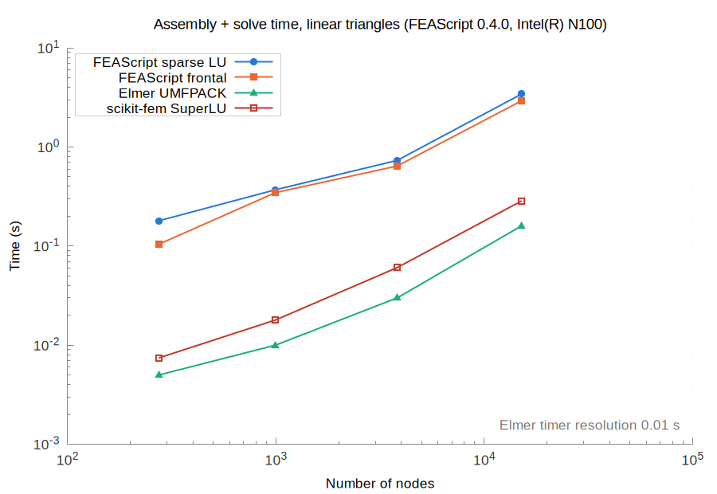
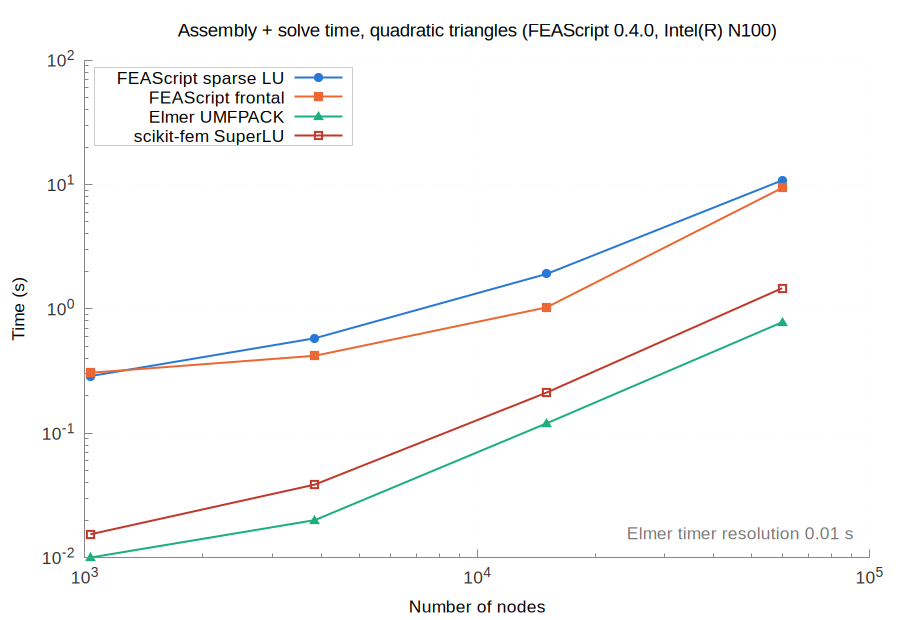
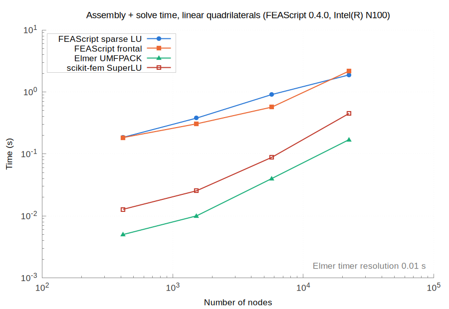
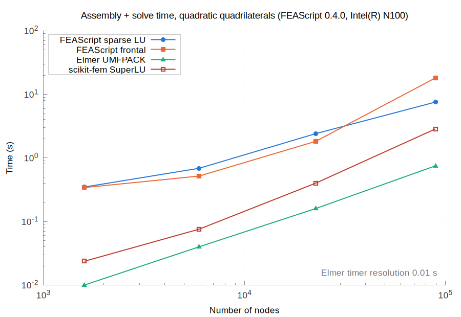

## Peak memory

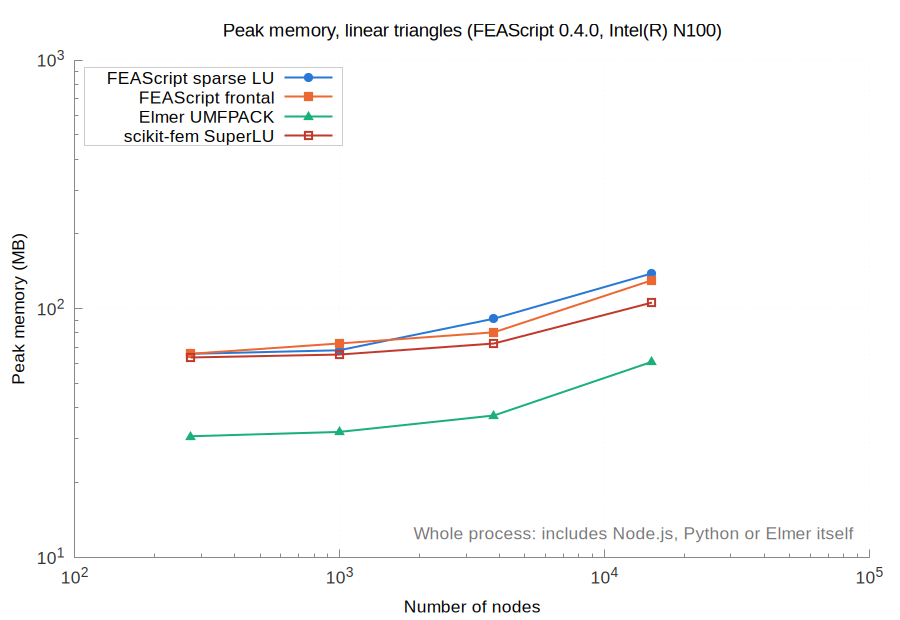
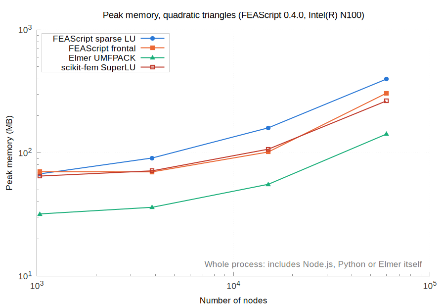
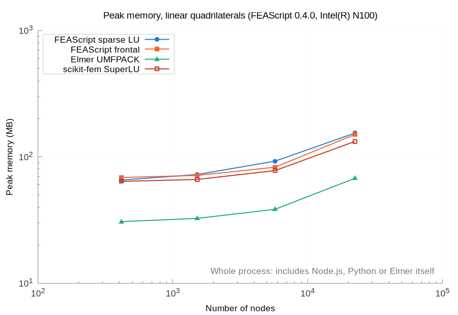
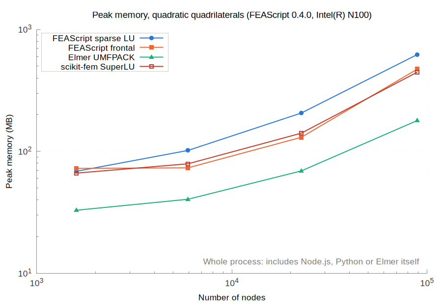

## Browsers

Chromium 156.0.8078.79, Firefox 159.0, each run in a fresh headless browser on one core, with FEAScript on the main thread of the page. The first solve in a fresh process on the largest mesh of each case, with the slowdown against Node.js:

| Case | Nodes | Node.js | Chromium | Firefox |
|---|---|---|---|---|
| FEAScript frontal, quadratic triangles | 59,885 | 9.38 s | 7.31 s (0.8×) | 12.13 s (1.3×) |
| FEAScript sparse LU, quadratic triangles | 59,885 | 10.79 s | 7.63 s (0.7×) | 19.94 s (1.8×) |
| FEAScript frontal, quadratic quadrilaterals | 89,209 | 18.10 s | 14.17 s (0.8×) | 27.32 s (1.5×) |
| FEAScript sparse LU, quadratic quadrilaterals | 89,209 | 7.55 s | 5.30 s (0.7×) | 12.73 s (1.7×) |

The browsers give the same solutions as Node.js, bit for bit. Cases with a first solve over 20 s are timed once, with one repeated solve, instead of five times with three repeated solves. A case without a point on a plot was not measured, and each such case is listed in this report.

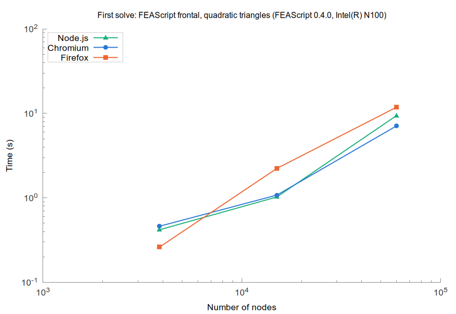
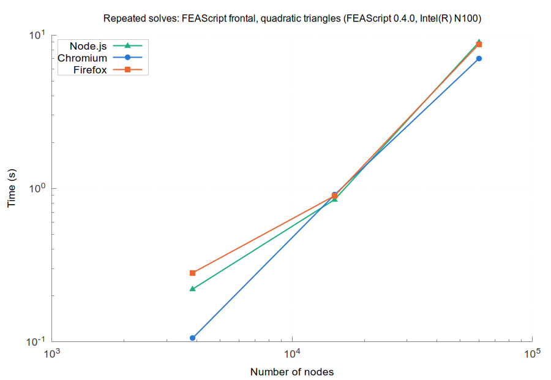
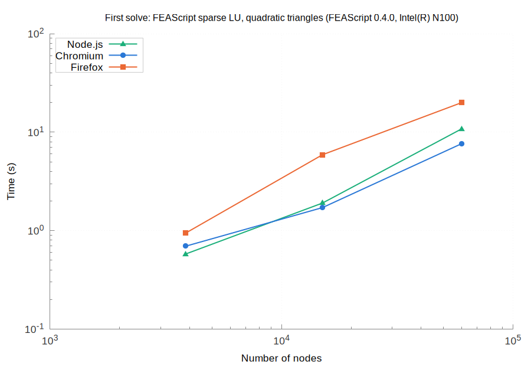
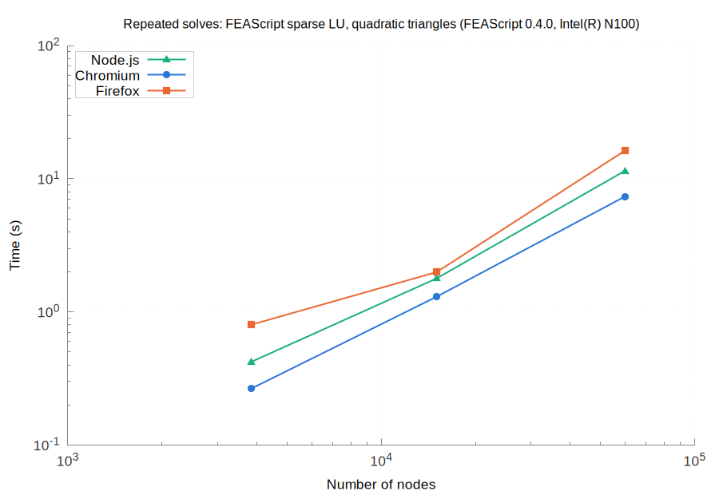
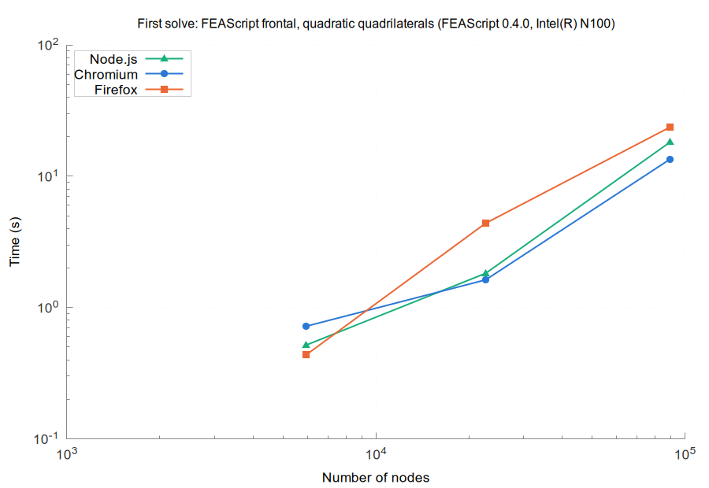
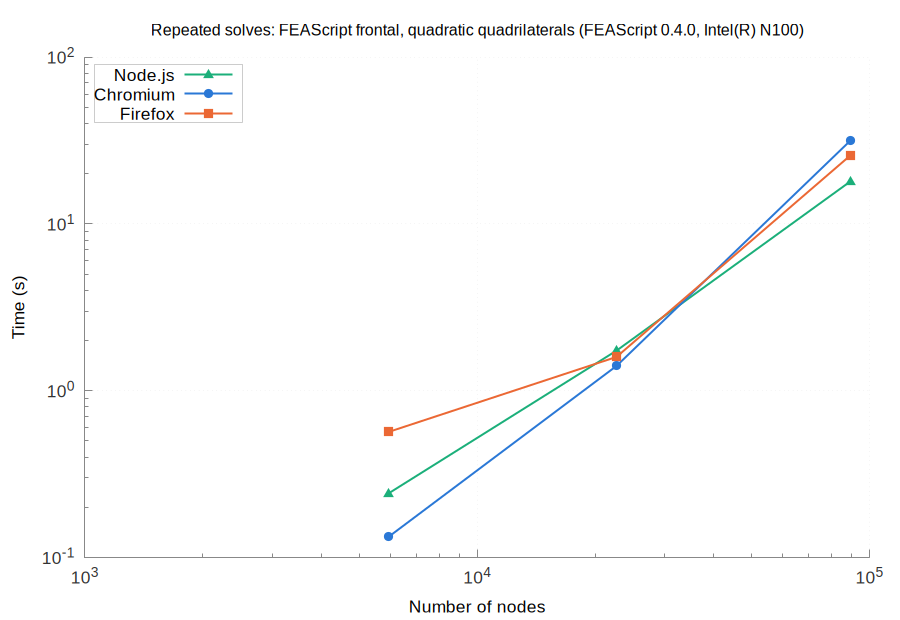
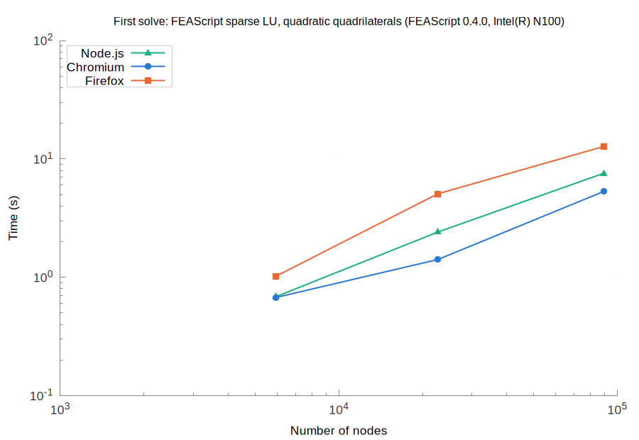
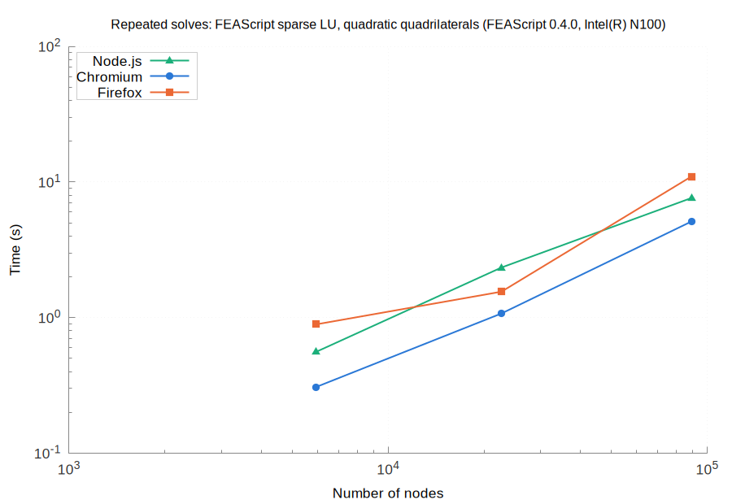
